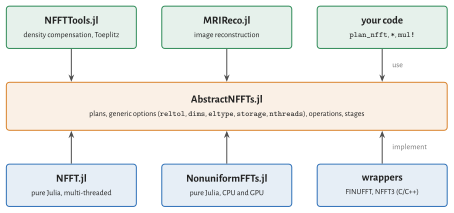

# Abstract Interface

`AbstractNFFTs.jl` defines what an NFFT plan is, independent of how it is computed. NFFT.jl is one
implementation, NonuniformFFTs.jl is another. Other libraries can implement the interface
themselves; code written against it runs with each of them. The comparison of NFFT.jl with
FINUFFT, ducc and NonuniformFFTs.jl on the [Performance](@ref) page uses its own benchmark harness
(`benchmark/` in the repository), not this interface.



!!! note
    If you just want to compute NFFTs, use NFFT.jl and ignore this page.

## Backends

Each implementation has a backend type. Loading NFFT.jl activates its backend; others are chosen
explicitly, globally or within a scope:

```julia
plan_nfft(k, N)                                  # active backend
plan_nfft(NFFT.backend(), k, N)                  # explicit backend
AbstractNFFTs.set_active_backend!(NFFT.backend())
NFFT.activate!()                                 # the same, by convention
with(nfft_backend => OtherPackage.backend()) do  # within a scope
  nfft(k, f)
end
```

## Options: generic and specific

Plan constructors take two kinds of keyword arguments:

- **Generic options** mean the same for every implementation and must be accepted by all of them:

  | keyword | meaning |
  |:--|:--|
  | `reltol` | requested relative error (``\ell^2`` over random data), default `1e-8` |
  | `dims` | dimensions to transform: `:`, an integer or a contiguous range; the others are batch dimensions |
  | `eltype` | real element type of the data, default from the nodes |
  | `storage` | array type of data and workspace (`Array`, a GPU array type), default from the nodes |
  | `nthreads` | number of CPU threads, default `Threads.nthreads()` |

- **Specific options** belong to one implementation, such as `W`, `σ` and `window` of NFFT.jl.
  An implementation must reject options it does not know with an `ArgumentError`, never ignore
  them silently. Code that uses only generic options is portable.

## Operations

| function | meaning |
|:--|:--|
| `mul!(fHat, p, f)`, `p * f` | NFFT |
| `mul!(f, adjoint(p), fHat)`, `adjoint(p) * fHat` | adjoint NFFT (`transpose` for NFCT/NFST) |
| `size_in(p)`, `size_out(p)`, `size(p)` | array sizes; `size(p)` is the matrix size |
| `nodes(p)`, `nodes!(p, k)` | query and exchange the nodes |
| `accuracy(p)` | predicted relative error |
| `nfft(k, f)`, `nfft_adjoint(k, N, fHat)`, … | one-shot functions that create a plan |

The [stage interface](@ref "Stages of the NFFT") is optional and meant for implementations that are
built from the three classical stages.

## Writing an implementation

An implementation defines a backend, a plan type and the operations:

```julia
struct MyBackend <: AbstractNFFTBackend end
activate!() = AbstractNFFTs.set_active_backend!(MyBackend())
backend() = MyBackend()

mutable struct MyPlan{T,D,R} <: AbstractNFFTPlan{T,D,R}
  ...
end

function AbstractNFFTs.plan_nfft(b::MyBackend, k::AbstractMatrix, N::Dims; kwargs...)
  g, rest = generic_options(k, N; kwargs...)     # reltol, dims, eltype, storage, nthreads
  check_options(b, rest, (:myoption,))           # reject everything else
  ...
end

AbstractNFFTs.size_in(p::MyPlan) = ...
AbstractNFFTs.size_out(p::MyPlan) = ...
AbstractNFFTs.nodes(p::MyPlan) = ...
AbstractNFFTs.nodes!(p::MyPlan, k) = ...
AbstractNFFTs.accuracy(p::MyPlan) = ...
LinearAlgebra.mul!(fHat, p::MyPlan, f) = ...
LinearAlgebra.mul!(f, p::Adjoint{<:Complex,<:MyPlan}, fHat) = ...
```

In the type parameters, `T` is the real element type of the data, `D` the number of dimensions
of the input and `R` that of the output (`R = 1` without batch dimensions). Everything else,
`*`, `nfft`, `size` and the rules for automatic differentiation (ChainRules for Zygote, Enzyme),
is derived from these functions.

The test suite of NFFT.jl contains contract tests (`test/contract.jl`) that check an implementation
against the NDFT, for several tolerances `reltol` and with batch dimensions (`dims`); they take a
plan constructor as an argument and can be run against any backend.
