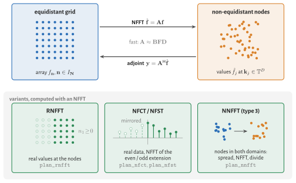
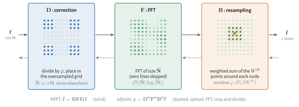

# Mathematical Background

This page defines the transforms that NFFT.jl computes and the three stages of the algorithm. The
derivation and the error analysis are in the [NFFT.jl paper](https://arxiv.org/abs/2208.00049),
whose notation we follow.



The NFFT maps an array on an equidistant grid to values at non-equidistant nodes, its adjoint maps
back. The other transforms are built on it: the RNFFT restricts it to real values at the nodes, the
NFCT and NFST apply it to the even or odd extension of real data, and the NNFFT wraps it into a
spreading and a division to reach non-equidistant points on both sides
(see [Other transforms](@ref)).

!!! note
    The NFFT is also called NUFFT, and in MRI gridding. FINUFFT and others classify the transforms
    into types: type 2 is the NFFT, type 1 its adjoint, type 3 the NNFFT with non-equidistant
    points on both sides.

## NDFT

Let ``\bm{N} \in \mathbb{N}^D`` be the size of a ``D``-dimensional array
``\bm{f} = (f_{\bm{n}})_{\bm{n} \in I_{\bm{N}}}`` sampled on a grid, indexed by the centred
multi-index set
```math
I_{\bm{N}} := \mathbb{Z}^D \cap \prod_{d=1}^D \left[-\frac{N_d}{2},\frac{N_d}{2}\right).
```
The non-equidistant discrete Fourier transform (NDFT) evaluates the trigonometric polynomial with
coefficients ``f_{\bm{n}}`` at ``J`` nodes ``\bm{k}_j \in \mathbb{T}^D``, where
``\mathbb{T} := [-1/2, 1/2)`` is the torus:
```math
\hat{f}_j := \sum_{\bm{n} \in I_{\bm{N}}} f_{\bm{n}} \, \mathrm{e}^{-2\pi\mathrm{i}\,\bm{n}\cdot\bm{k}_j},
\quad j = 1,\dots,J \qquad \textit{(equidistant to non-equidistant)}.
```
Its adjoint maps values at the nodes back to the grid,
```math
y_{\bm{n}} = \sum_{j=1}^{J} \hat{f}_j \, \mathrm{e}^{2\pi\mathrm{i}\,\bm{n}\cdot\bm{k}_j},
\quad \bm{n} \in I_{\bm{N}} \qquad \textit{(non-equidistant to equidistant)}.
```
In general the adjoint is not the inverse; see [Density Compensation and Toeplitz Kernels](@ref).

!!! note
    The indices in ``I_{\bm{N}}`` are centred around zero, while an ordinary DFT runs over
    ``0,\dots,N_d-1``. An `fftshift` converts one representation into the other.

## Matrix notation

With ``|\bm{N}| := \prod_{d=1}^D N_d`` the NDFT is the matrix–vector product
``\hat{\bm{f}} = \bm{A} \bm{f}`` with
```math
\bm{A} := \left( \mathrm{e}^{-2\pi\mathrm{i}\,\bm{n}\cdot\bm{k}_j} \right)_{j=1,\dots,J;\; \bm{n} \in I_{\bm{N}}}
\in \mathbb{C}^{J \times |\bm{N}|},
```
and the adjoint is ``\bm{y} = \bm{A}^{\mathsf{H}} \hat{\bm{f}}``. A plan in NFFT.jl behaves like
this matrix: `p * f`, `adjoint(p) * fHat`, `size(p) == (J, prod(N))`.

## NFFT

The direct evaluation costs ``\mathcal{O}(J |\bm{N}|)`` operations. The NFFT approximates
``\bm{A}`` by a product of three matrices,
```math
\bm{A} \approx \bm{B} \bm{F} \bm{D},
```
which costs ``\mathcal{O}(|\tilde{\bm{N}}| \log |\tilde{\bm{N}}| + J W^D)``. Here
``\tilde{\bm{N}} \approx \sigma \bm{N}`` is the size of an oversampled grid with oversampling
factor ``\sigma > 1``, and ``W`` is the width of the window function in grid points. Each matrix is
one stage of the algorithm:

1. **Resampling correction** ``\bm{D} \in \mathbb{C}^{|\tilde{\bm{N}}| \times |\bm{N}|}``: divides
   ``\bm{f}`` by the Fourier transform ``\hat{\varphi}`` of the window function and places the result
   in the zero-padded oversampled array (including the `fftshift`).
2. **FFT** ``\bm{F} \in \mathbb{C}^{|\tilde{\bm{N}}| \times |\tilde{\bm{N}}|}`` on the oversampled
   grid.
3. **Resampling** ``\bm{B} \in \mathbb{C}^{J \times |\tilde{\bm{N}}|}``: a sparse matrix that
   interpolates the oversampled grid at each node with the window function ``\varphi``, i.e. it
   combines the ``W^D`` grid points around the node.



The adjoint NFFT applies the adjoint stages in reverse order,
```math
\bm{A}^{\mathsf{H}} \approx \bm{D}^{\mathsf{H}} \bm{F}^{\mathsf{H}} \bm{B}^{\mathsf{H}}.
```
The first of them, ``\bm{B}^{\mathsf{H}}``, adds the weighted value of each node to the grid points
around it; this is the costly and hard-to-parallelise part of the adjoint.

!!! note "Why resampling and not convolution"
    The matrix ``\bm{B}`` is often called convolution and ``\bm{D}`` deconvolution. Since ``\bm{B}``
    evaluates the window at node-dependent offsets, it is not shift-invariant and therefore not a
    convolution. We use the terms resampling and resampling correction, as in the paper.

## Window, width and oversampling

The accuracy of the approximation depends on three choices: the window function ``\varphi``, its
width ``W`` and the oversampling factor ``\sigma``. A larger ``W`` or ``\sigma`` reduces the
error, at a higher cost in the resampling (``W^D`` per node) or in the FFT (``\sigma^D``). In the
notation of the paper the window has the half width ``m``, so ``W = 2m``; NFFT.jl also allows odd
widths.

NFFT.jl chooses all three from the requested relative error, see [Accuracy and Parameters](@ref).

## Other transforms

**Real values at the nodes (RNFFT).** If the values at the nodes are real, the coefficients are
Hermitian, ``f_{-\bm{n}} = \overline{f_{\bm{n}}}``, and the half with ``n_1 \ge 0`` determines
them. The RNFFT takes this half and computes on a real oversampled grid, which saves half of the FFT
and of the adjoint resampling; see [Real Data](@ref).

**Cosine and sine transforms (NFCT, NFST).** The non-equidistant fast cosine and sine transforms
of NFFT3 use real data and nodes in ``[0, 1/2]^D``:
```math
\hat{f}_j = \sum_{\bm{n}} f_{\bm{n}} \prod_{d=1}^D \cos(2\pi n_d k_{d,j}),
\qquad
\hat{f}_j = \sum_{\bm{n}} f_{\bm{n}} \prod_{d=1}^D \sin(2\pi n_d k_{d,j}),
```
with ``n_d = 0,\dots,N_d-1`` (cosine) and ``n_d = 1,\dots,N_d`` (sine) for an array of size ``\bm{N}``. Their transposes take
the role of the adjoint. NFFT.jl computes them as NFFTs of the even and odd extension of the data,
see [Cosine and Sine Transforms](@ref).

**Non-equidistant on both sides (NNFFT).** For arbitrary real sources ``\bm{y}_l`` and targets
``\bm{k}_j``,
```math
\hat{f}_j = \sum_{l} f_l \, \mathrm{e}^{-2\pi\mathrm{i}\,\bm{k}_j\cdot\bm{y}_l}.
```
The sources are spread with a window onto an equidistant grid, an NFFT evaluates that grid at the
scaled targets, and a division by the Fourier transform of the window undoes the spreading; see
[Non-equidistant in Both Domains](@ref).
