# Benchmark details

The measurements behind the [Performance](@ref) page and more: the CPU suites with the M1 Max as
reference machine and the Zen 3 machine, single precision, the GPU comparisons, and the explorer
with all measurements. Setup, method and caveats are described on the
[Performance](@ref "How the benchmarks measure") page.

## Overview in single precision

The overview of the speed ratios in single precision (median over the tolerances ``10^{-2}`` to
``10^{-6}``, smallest and largest ratio, Pareto fronts as for double precision).

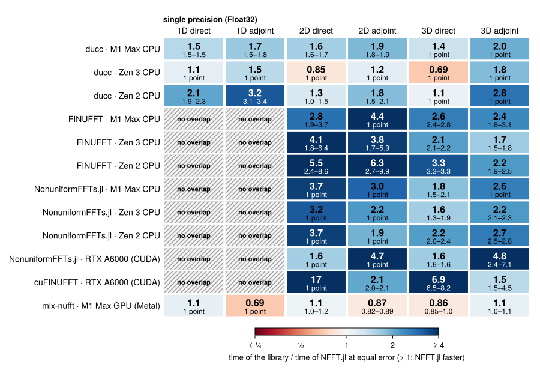

In 1D with ``N = 2^{18}`` FINUFFT, NonuniformFFTs.jl and cuFINUFFT do not
  get below an error of ``8 \cdot 10^{-3}`` to ``1.5 \cdot 10^{-2}``, while NFFT.jl's largest error is
  ``1.3 \cdot 10^{-3}`` (CPU) and ``2.8 \cdot 10^{-3}`` (CUDA). On the CPU part of this comes from the
  benchmark: the adapters of FINUFFT and NonuniformFFTs.jl pass the nodes as ``2\pi \bm{k}_j``
  rounded to single precision and measure against ``\bm{k}_j``. On the M1 Max GPU the medians against
  mlx-nufft are 0.86–1.1 in the direct transforms; its 1D and 2D adjoint are faster (0.69, 0.87).

## CPU

The figures and the text of this section are for the M1 Max; the selector switches the figures to
the Zen 3 machine (the subsection [Zen 3](@ref) summarises them). Speed ratios as on the
[Performance](@ref) page: time of the other library over the time of NFFT.jl at the same measured
error, above 1 NFFT.jl is faster.

```@raw html
<div class="nfft-machine-switch" data-figures="accuracy density sizes threads batch real nnfft"
     data-machines='{"": "Apple M1 Max", "amd-epyc-7763": "AMD EPYC 7763 (Zen 3)"}'></div>
```

The first three figures show the speed ratio against one parameter each: accuracy, node density,
problem size; columns are the dimensions, rows the direct and the adjoint transform.

### Accuracy

Tolerance sweep from ``10^{-2}`` to ``10^{-14}``; solid: double precision, dashed: single precision
(``10^{-2}`` to ``10^{-6}``).

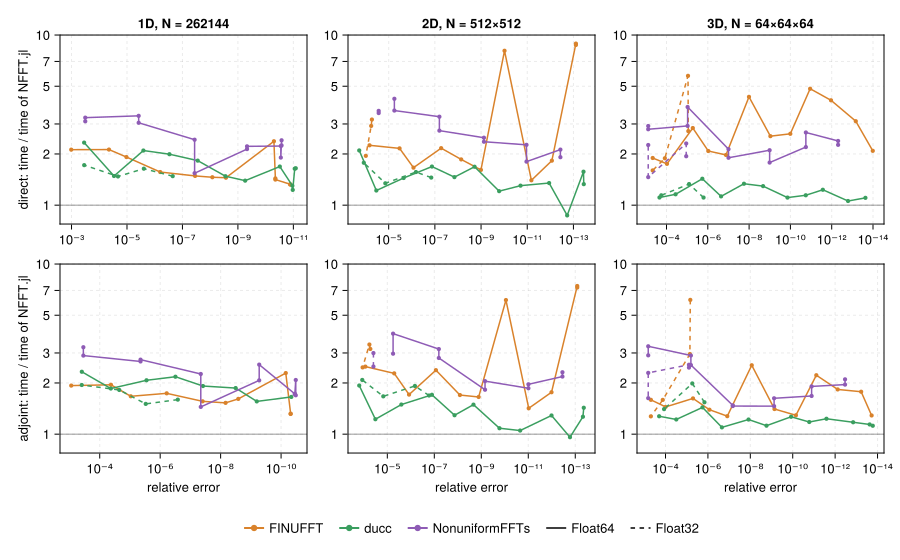

- **1D**: NFFT.jl is 1.5–2.3× faster than ducc and 1.2–2.1× faster than NonuniformFFTs.jl at every
  accuracy, 1.2–1.4× faster than ducc in single precision. FINUFFT is 1.5–2.4× slower, except at its
  accuracy limit around ``10^{-11}``, where it comes within 5 %.
- **2D and 3D**: ducc is the closest competitor. NFFT.jl is ahead by 1.1–1.4× at low and medium
  accuracy; from about ``10^{-11}`` on the two are within 10 % of each other, and ducc is ahead in
  the 3D direct transform at ``10^{-13}`` (5 %). FINUFFT is 1.1–5.3× slower, at single tolerances in
  2D up to 12×; NonuniformFFTs.jl 1.3–2.7×.
- **Single precision**: NFFT.jl is ahead of ducc by 1.3–1.8× in 2D and 3D.

### Node density

Nodes per mode ``J/|\bm{N}|`` from 0.01 to 100 at a tolerance of ``10^{-8}``; ``\bm{N}`` as in the
figures above for ``J/|\bm{N}| \geq 1`` (``2^{16}``, ``256^2``, ``32^3``) and four times larger
below (``2^{20}``, ``1024^2``, ``64^3``).

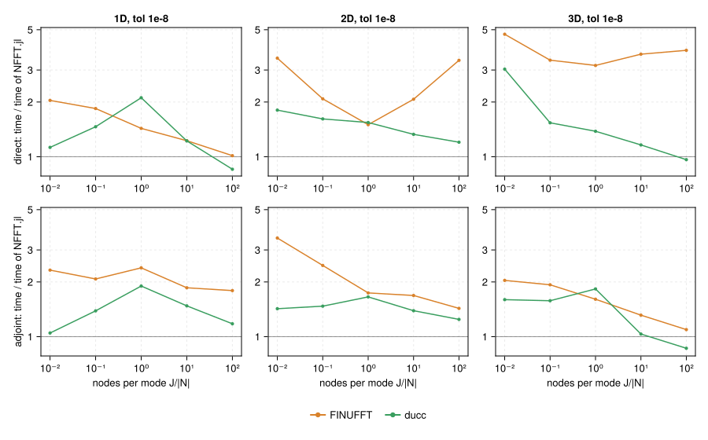

At low density the FFT dominates; NFFT.jl's pruned FFT passes make it 1.2–2.8× faster than ducc and
1.7–5.1× faster than FINUFFT. With growing density the resampling dominates and the gap narrows: at 100
nodes per mode ducc is faster in the 1D direct transform (9 %) and in 3D (5 % direct, 14 % adjoint);
FINUFFT stays behind in all cases.

### Problem size

``J = |\bm{N}|`` from ``10^3`` to about ``4 \cdot 10^6``, tolerance ``10^{-8}``.

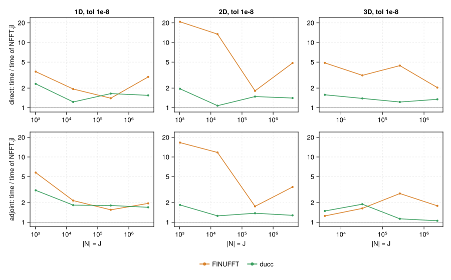

For small problems the cost of starting and waking threads dominates; NFFT.jl runs each stage of
a small transform on only as many tasks as its work pays for. At ``|\bm{N}| = 10^3`` it is 1.7–2.6×
faster than ducc and 3–25× faster than FINUFFT. Around ``1.6 \cdot 10^4`` (1D ``2^{14}``, 2D
``128^2``) ducc is 4–5 % faster in the direct transform; at all other sizes NFFT.jl is ahead, in 3D by
1.05–1.8×.

### Threads

Speedup over one thread at a tolerance of ``10^{-8}`` (solid: direct, dashed: adjoint; dotted:
ideal).

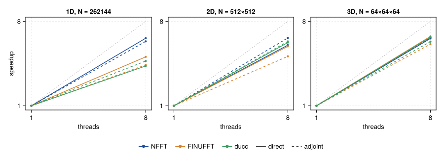

With 8 threads NFFT.jl reaches a speedup of 4.9–5.2 in 1D and 6.5–7.0 in 2D and 3D. ducc reaches
3.4–3.5 in 1D and 6.0–6.7 in 2D and 3D, FINUFFT 2.9–3.5 in 1D and 4.5–5.5 in 2D and 3D.

### Many transforms with the same nodes

Time per transform for ``L`` transforms with the same nodes (`dims`, FINUFFT's `ntrans`; ducc
loops over the transforms), tolerance ``10^{-8}``.

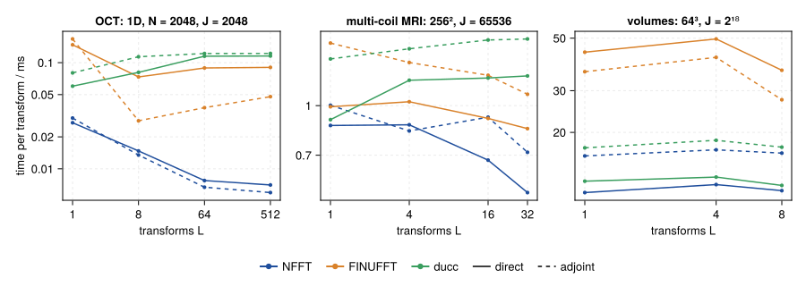

Transforms with the same nodes share the window evaluation. For many short 1D transforms (OCT:
512 A-scans) NFFT.jl runs the transforms in parallel on single-threaded copies of the plan and
needs 7 µs per transform, 8–19× less than FINUFFT and ducc; a single A-scan takes 38 µs, 1.6–2×
less than ducc. For multi-coil MRI NFFT.jl is 1.3–1.4× faster than FINUFFT and 2.0–2.2× faster
than ducc; for volumes it gains nothing from batching and stays 5–10 % ahead of ducc.

### Real data

The RNFFT (real values at the nodes), the NFCT and the NFST against the complex NFFT of the same
size, tolerance ``10^{-8}``.

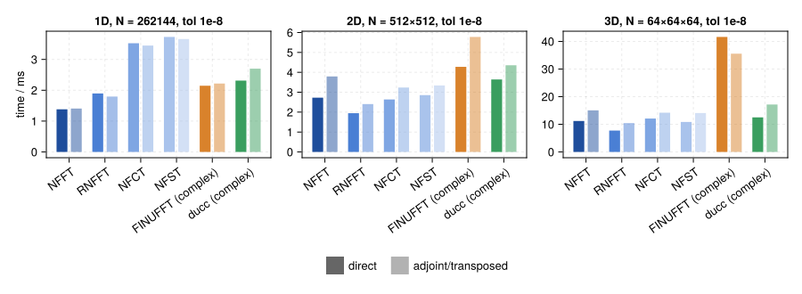

The RNFFT computes on a real grid and needs 62–77 % of the time of the complex NFFT. NFCT and NFST
cost 0.83–1.10× the complex NFFT in 2D and 3D; in 1D they are 1.4–1.5× slower.

### Non-equidistant in both domains (NNFFT)

The NNFFT (FINUFFT's type 3) maps values at arbitrary sources ``\bm{y}_l`` to arbitrary targets
``\bm{k}_j``. Here ``|\bm{N}|`` sources uniformly random in ``\prod_d [-N_d/2, N_d/2)`` and as many
targets in ``[-1/2, 1/2)^D``, the space-frequency extent of an NFFT of size ``\bm{N}`` (``2^{16}``,
``256^2``, ``32^3``); tolerance sweep, solid: double, dashed: single precision.

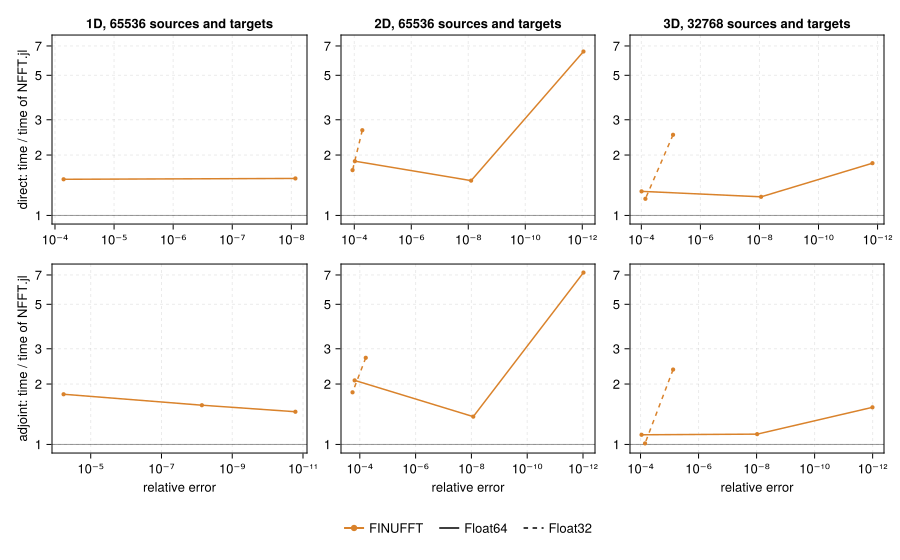

NFFT.jl is up to 1.7× faster than FINUFFT, and 8× at the highest accuracy in 2D; in 3D around
``10^{-4}`` FINUFFT's adjoint is 10 % faster. NFFT.jl computes grid
positions and phases in double precision also for single-precision data; with the large coordinates
of the type 3 this matters: in single precision FINUFFT stays at an error of ``10^{-2}`` in 1D and
needs 2.1–2.5× longer for errors around ``10^{-5}`` in 3D. Around ``10^{-4}`` in 3D single precision
FINUFFT is on par in the direct and 15 % faster in the adjoint transform.

### Zen 3

AMD EPYC 7763 with 8 threads, provisional (see the setup on the [Performance](@ref) page). The accuracy figure of this
machine; the others with the selector at the top of this section.

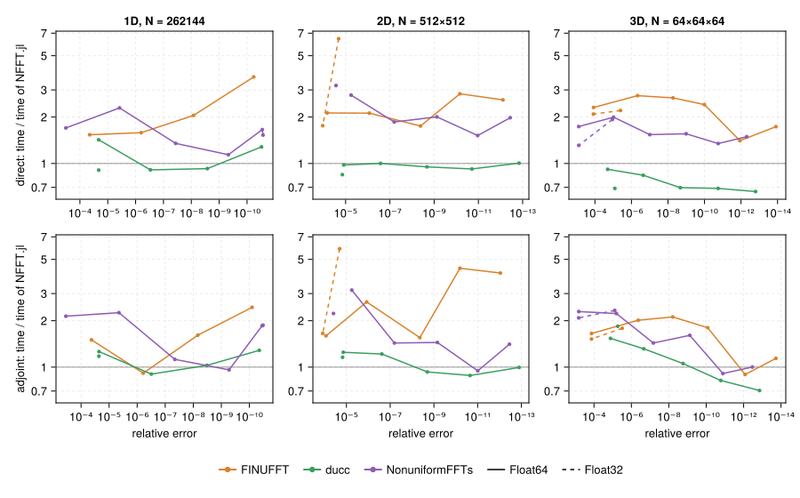

Against FINUFFT and NonuniformFFTs.jl the picture of the M1 Max holds: medians 1.7–2.8 and 1.4–1.9
in double precision, single measurements down to 0.9. Against ducc it shifts: ratios 1.3–1.5 in 1D
and 0.88–1.2 in 2D; in 3D ducc's direct transform is 1.1–1.5× faster (ratios 0.66–0.92), and its
adjoint below ``10^{-10}`` up to 1.4× (ratios down to 0.71). In the density sweep NFFT.jl leads at
low density; at 100 nodes per mode ducc's direct transform is faster in all three dimensions (3D:
ratio 0.58), and so is its 3D adjoint.

## On GPUs

NFFT.jl runs on GPUs from the same code base (see [GPU](@ref) and [How NFFT.jl Works](@ref "GPUs")).
The data are on the device; plan and node setup are not timed; the GPU is synchronised after every
call.

### CUDA

Time against measured error on the RTX A6000, the Pareto front of each library (errors within
15 % of each other count as equal, the faster point stays; the same for the ratios below and for
Metal); solid: double, dashed: single precision. The A6000 has 1/32 of its single-precision throughput in double
precision. NFFT.jl ran at a revision with the unrolled interpolation kernel, before the subproblem
adjoint in double precision. cuFINUFFT runs from Python and is timed with CuPy, the others through
the Julia benchmark worker.

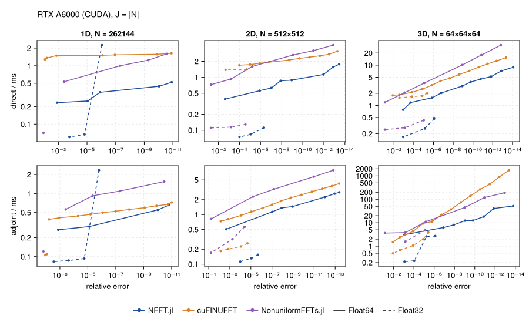

Where a line ends, the library reaches no smaller error. In single precision and 1D cuFINUFFT stays
at ``8.6 \cdot 10^{-3}`` and NonuniformFFTs.jl at ``1.5 \cdot 10^{-2}``; NFFT.jl reaches
``1.6 \cdot 10^{-6}``: it computes grid positions in double precision during planning. In double
precision NonuniformFFTs.jl 0.9.8 on CUDA does not get below ``7 \cdot 10^{-6}`` (1D) to
``1.3 \cdot 10^{-5}`` (3D), and its error grows again for smaller tolerances, up to
``3.5 \cdot 10^{-5}`` in 3D; on the CPU the same sweep gives errors down to ``3 \cdot 10^{-11}``
(1D) and ``4 \cdot 10^{-13}`` (2D).

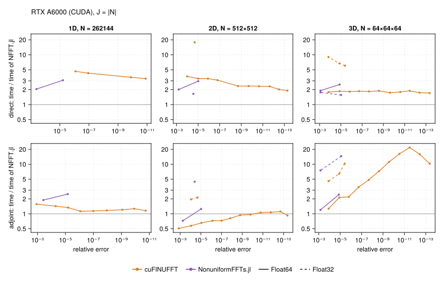

In double precision NFFT.jl is 3.3–4.7× faster than cuFINUFFT in the 1D direct transform, 1.9–3.7×
in 2D and 1.7–1.9× in 3D; in the adjoint 1.1–1.6× in 1D and 1.3–22× in 3D, the more the higher the
accuracy. cuFINUFFT's 2D adjoint is up to 2× faster at low accuracy (ratios 0.51–1.1). In single
precision NFFT.jl is 2.0–18× faster than cuFINUFFT in 2D and 3D. Against NonuniformFFTs.jl the
ratios are 1.2–3.1 in double and 1.6–15 in single precision, except its 2D adjoint in double
precision (0.72–1.3).

For the large sizes ``2^{22}``, ``2048^2``, ``160^3`` the ratios to cuFINUFFT are closer to 1 in
1D and 2D: 0.91–1.1 in 1D, 1.1–1.4 in the 2D direct and 0.57–1.1 in the 2D adjoint transform; in
3D 1.1–1.6 (direct) and 1.4–21 (adjoint).

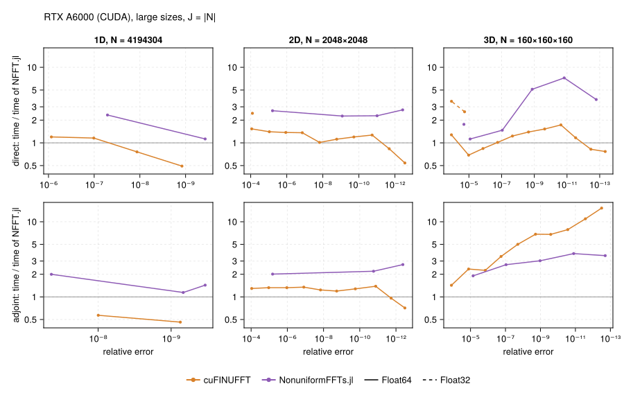

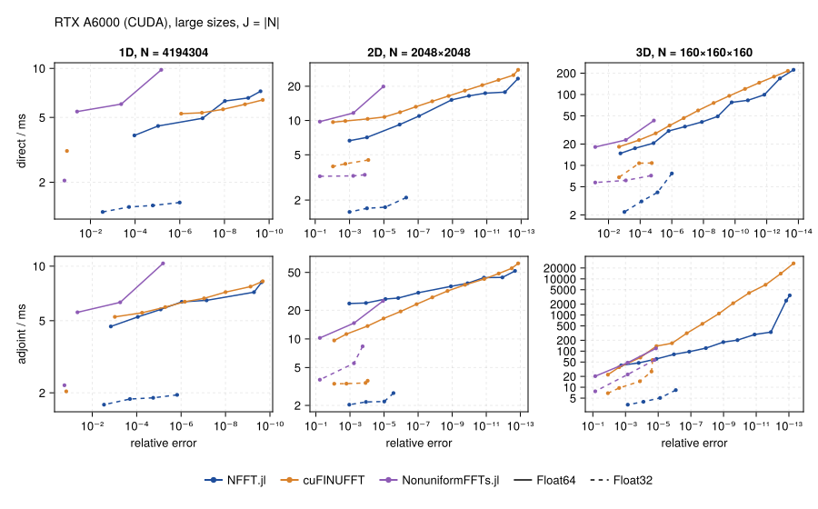

### Metal

Apple M1 Max GPU, single precision, tolerances ``10^{-2}`` to ``10^{-5}``: time against measured
error, Pareto fronts.

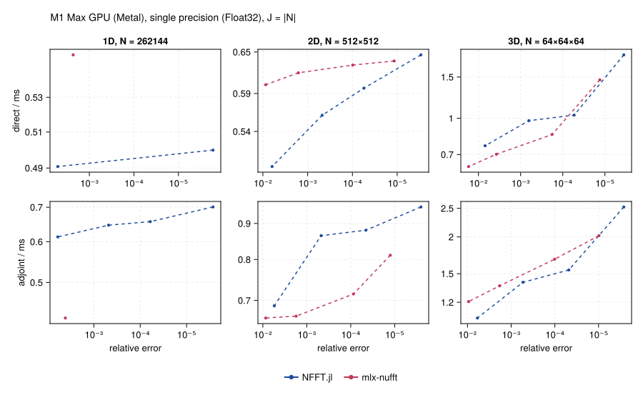

mlx-nufft uses the same subproblem scheme for the adjoint (see
[How NFFT.jl Works](@ref "GPUs")). Its 1D error stays at ``2.3 \cdot 10^{-3}`` for ``N = 2^{18}``.
At equal error NFFT.jl's direct transform is 1.0–1.2× faster in 1D and 2D, mlx-nufft's up to 1.18×
in 3D (ratios 0.85–1.0); mlx-nufft's adjoint is 1.1–1.45× faster in 1D and 2D (ratios 0.69–0.89),
in 3D the adjoints are within 10 %.

Measurements on AMD GPUs are still missing. NFFT.jl on all four devices is compared on the
[Performance](@ref "The same code on four devices") page.

## Parameters or implementation

A speed ratio between two libraries mixes the parameters each one chooses (window, ``W``, grid) with
the implementation. The suite `decomposition` separates the two: NFFT.jl also runs with the
parameters the other library would choose (expert options `window = CustomWindow(…)` and
`gridsize`), so that the ratio splits into a parameter factor and an implementation factor. FFT
planning counts as implementation: every library plans with its own default flag; the suite
`fftflags` shows what `ESTIMATE` and `MEASURE` change for the other libraries. Which technique
accounts for how much of NFFT.jl's own speed can be measured with the ablation switches described
in [How NFFT.jl Works](@ref "Measuring the techniques").

## Further measurements

The [Explorer](@ref) also holds measurements without a figure of their own:

- **Node distributions** (suite `nodes`): uniform, radial spokes through the centre (as in MRI)
  and nodes clustered in the centre (normal distribution) change the time of each library by less
  than 15 %.
- **NFFT.jl 0.14** (suite `history`): at the same requested tolerance NFFT.jl 1.0 is up to 4.8×
  faster in the direct and up to 14× faster in the adjoint transform (2D with 8 threads, where 0.14
  used FFTW's slow threaded `ESTIMATE` plans); 0.14 misses its tolerance by a factor of 3–4, so at
  equal error the factors are larger.

## Explorer

All measurements of this page and the [Performance](@ref) page. Choose the machine, a suite, the quantity on the y axis and the
parameters; hovering a point shows the details (including the window width ``W`` and oversampling
factor ``σ`` NFFT.jl chose).

```@raw html
<div id="nfft-explorer"></div>
```

## Reproducing

```
julia benchmark/bench.jl run fast                  # ≈ 15 s, NFFT.jl alone
julia benchmark/bench.jl run quick                 # ≈ 1 min, NFFT.jl, FINUFFT and ducc
julia benchmark/bench.jl run all --save            # all suites of this page
julia benchmark/bench.jl run lite --save           # the figures with every other point, ≈ 10 min
julia benchmark/bench.jl report                    # figures and explorer data
julia benchmark/bench.jl run contract              # delivered error against the tolerance
julia benchmark/bench.jl run metal                 # Apple GPU, with mlx-nufft
julia benchmark/bench.jl run cuda                  # Nvidia GPU; cuFINUFFT: benchmark/cufinufft.py
julia benchmark/bench.jl run decomposition         # parameter and implementation factors
julia benchmark/bench.jl run fftflags              # the other libraries with ESTIMATE and MEASURE
julia benchmark/bench.jl ab v1.0.0                 # the working tree against a release
```

Each library runs in its own process and environment, with its default parameters apart from
the tolerance and the number of threads. The error is the relative ``\ell^2`` error against the
exact NDFT on 64 sampled outputs, the time the minimum over repeated calls of a precomputed plan.
The results of each machine are in `benchmark/results/<machine>/`; details in `benchmark/README.md`.
