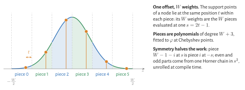
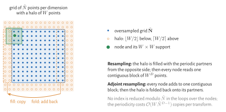
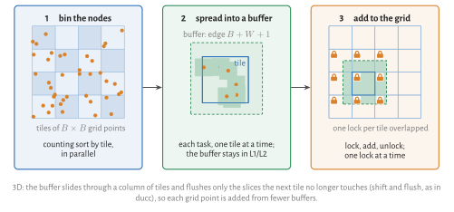
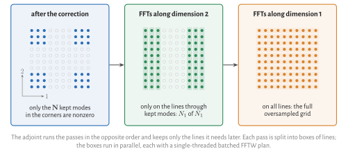
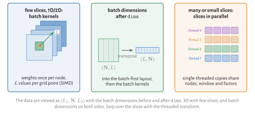
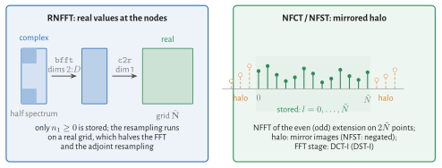
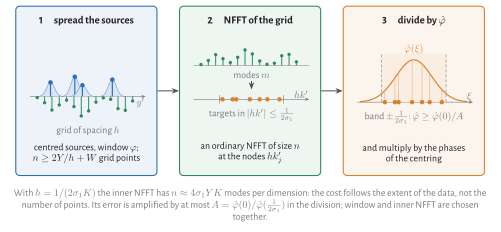
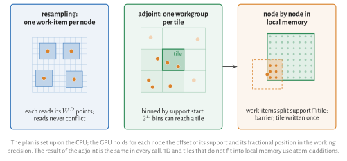

# How NFFT.jl Works

This page explains what happens inside a plan and why it is fast. It is meant for readers who want
to understand the implementation, compare it with other libraries or contribute; for using
NFFT.jl, none of it is needed. The mathematics behind the three stages is in
[Mathematical Background](@ref).

## What a plan precomputes

Creating a plan does all work that depends only on the nodes and the sizes:

- **Parameters.** From `reltol` the plan picks window family, width ``W`` and oversampling factor
  ``\sigma`` with the lowest predicted cost (see [Accuracy and Parameters](@ref)).
- **The window** as ``W`` polynomial pieces (below), and the correction factors
  ``1/\hat\varphi`` for the kept modes.
- **The nodes, binned into tiles** of the oversampled grid (below), with their coordinates in the
  order of the tiles.
- **FFT plans** for the passes of the pruned FFT, and the work arrays: the padded grid and one tile
  buffer per task.

A transform then allocates no arrays, only a few kilobytes for scheduling its tasks. `copy(p)`
shares the read-only parts and gets its own work arrays, so copies can run concurrently.

## The window as polynomial pieces

The resampling needs ``W`` window values per node and dimension. Evaluating a Kaiser–Bessel or
exponential-of-semicircle window directly costs a square root and an exponential or hyperbolic
sine each. NFFT.jl splits the window into ``W`` pieces of one grid point width and fits each by a
polynomial of degree ``W+3`` in the offset ``s``. All ``W`` support points of a node lie at the same
offset within their pieces, so one ``s`` gives all ``W`` weights. The window is symmetric, which
pairs the pieces: their even and odd parts come from one Horner chain in ``s^2``, unrolled at
compile time for each ``W``. The weights cost a few nanoseconds per node and dimension, and the
accuracy is that of the window itself.

## The grid with a halo

The oversampled grid is periodic: the support of a node near the edge continues on the other side.
NFFT.jl stores the grid with a halo of ``W`` extra points per dimension. Before the resampling the
halo is filled with copies from the opposite side, after the adjoint resampling it is added back.
In between, every node reads or writes one block of ``W^D`` points without wrap-around, and the
inner loops contain no modulo operations and no branches.

The node positions on the grid are always computed in double precision, also for single-precision
data: in `Float32`, ``k \tilde N`` would be off by about ``10^{-2}`` grid points for
``\tilde N \approx 4 \cdot 10^5``.

## Resampling on tiles

At plan time the nodes are sorted into tiles of the grid by a parallel counting sort. A transform
processes the grid tile by tile, and every task takes the next tile from a shared counter:

- **Resampling** (grid to nodes): the task copies the tile with its halo into a private buffer and
  computes the values of the tile's nodes from it. Reading from the compact copy instead of the
  large grid makes the time independent of the grid size, which otherwise varies by up to 65 %
  through cache conflicts.
- **Adjoint resampling** (nodes to grid): the task adds the nodes of its tile into a zeroed private
  buffer of edge ``B + W + 1``, which stays in the L1 or L2 cache, and then adds the buffer to the
  grid. Neighbouring buffers overlap, so this addition takes a lock for each tile of the grid it
  touches, one lock at a time. In 3D the buffer slides through a column of tiles and adds only the
  slices that the next tile no longer touches.

Each node is handled exactly once, by one task, and no two tasks write to the same memory at the
same time.

## The FFT

Before the FFT of the direct transform, only the ``|\bm{N}|`` kept modes in the corners of the
grid are nonzero; after the FFT of the adjoint, only those are needed. NFFT.jl runs the FFT as one
pass per dimension and skips the lines that contain only zeros (direct) or are not needed later
(adjoint). In 2D with ``\sigma = 2`` the first pass of the direct transform touches half of the
lines, in 3D the first two passes a quarter and a half; the adjoint saves the same in its last
passes. Each pass is split into boxes of lines that run in parallel, each with a single-threaded
batched FFTW plan: with `ESTIMATE`, FFTW's own threading produces plans up to 17 times slower than
`MEASURE` plans, while single-threaded batched `ESTIMATE` plans come within 10–20 % of `MEASURE`.
In 1D, FFTW's threading is used. The grid sizes are products of 2, 3, 5 and 7,
not powers of two, so that ``\sigma`` can be chosen freely.

## Batch strategies

With `dims`, the data are viewed as ``(L_1, \bm{N}, L_3)``: ``L = L_1 L_3`` slices, with the batch
dimensions before and after the transformed ones (see [Transforms along Dimensions](@ref) for the
usage). An NFFT plan chooses one of four strategies at plan time, in this order:

- **Slices in parallel**, if there are several threads and either many slices (``L \ge 4`` per
  thread) or at least one small slice per thread (``J + |\bm{N}| \le 2^{15}``): every thread runs
  whole slices on its own single-threaded copy of the plan, which shares nodes, window and
  correction factors. Small transforms cannot use many threads; for 512 short 1D transforms this is
  about 50 times faster than running them one after the other.
- **Batch kernels** (1D and 2D, batch dimensions only before `dims`): the grid stores the ``L``
  values of each grid point next to each other. The window weights of a node are evaluated once and
  applied to all ``L`` values with SIMD instructions.
- **Transposition** (1D and 2D, batch dimensions only after `dims`): the data are transposed into
  the layout of the batch kernels and back.
- **A loop** over the slices with the threaded transform (3D and higher, or batch dimensions on both
  sides of `dims`).

RNFFT, NFCT and NFST plans run slices in parallel or loop over them. On a GPU, every kernel
processes all slices in one launch.

## Real-valued transforms

- **RNFFT.** The values at the nodes are real exactly when the oversampled grid is real. The plan
  stores the half spectrum (``n_1 \ge 0``), runs complex backward FFTs along dimensions
  ``2, \dots, D`` on it and a complex-to-real FFT along dimension 1 into a real grid. The FFT and
  the adjoint resampling then cost about half of those of the complex NFFT.
- **NFCT and NFST** are NFFTs of the even and odd extension of the data on ``2\tilde{\bm N}``
  points. Only the points ``0, \dots, \tilde N`` of each dimension are stored; the halo holds their
  mirror images, with a sign change for the NFST, so the resampling loops of the NFFT run
  unchanged. The FFT stage is a DCT-I (DST-I), computed as a real FFT of each extended line: FFTW's
  own DCT-I (`REDFT00`) needs ``\mathcal O(n^2)`` operations for many sizes when planned with
  `ESTIMATE`, and planning it with `MEASURE` takes seconds to minutes.

## Non-equidistant on both sides

The NNFFT spreads the sources with an outer window onto an equidistant grid, evaluates the Fourier
series of that grid at the scaled targets with an ordinary NFFT, and divides by the Fourier
transform of the outer window. Both node sets are first centred, which turns into phase factors.
The spacing ``h = 1/(2\sigma_1 K)`` keeps the targets inside the band where the division is well
conditioned; the grid is large enough that the spreading never wraps around. With ``Y_d`` and
``K_d`` the half-widths of sources and targets, the inner NFFT has about ``4\sigma_1 Y_d K_d`` modes
per dimension (``\sigma_1`` between 1.2 and 2.5): the cost follows the extent of the data, not the
number of points. The error of the inner
NFFT is amplified by at most ``A = \hat\varphi(0)/\hat\varphi(1/(2\sigma_1))``, so the plan chooses
the outer window and the inner NFFT together, at the lowest predicted cost for the requested
error.

## GPUs

The plan is set up on the CPU, with the same parameter choice and window polynomial; the nodes are
binned on the CPU by the start of their support (below). The GPU holds,
for each node, the offset of its support in the grid and its fractional position, in the working
precision; the grid positions themselves were computed in double precision. Each stage is a
[KernelAbstractions.jl](https://github.com/JuliaGPU/KernelAbstractions.jl) kernel:

- **Resampling**: one work-item per node and transform; reads never conflict.
- **Adjoint resampling**, single precision: by subproblems. The nodes are binned by the start of
  their support; one workgroup takes up to 1024 nodes of one bin and adds them into the bin's tile,
  enlarged by the support width, in local memory. The work-items split the pairs of node and support
  point, so all of them are busy even at low node density. They add with integer atomics: the tile
  holds 32-bit fixed point numbers (scaled by ``2^{30}`` over the number of nodes times the largest
  value), since Apple GPUs have no atomic floating point additions in local memory, and integer
  sums do not depend on the order. The tile is then added to the grid with atomic additions, for the
  NFFT and RNFFT directly into the periodic grid. The result agrees between calls up to rounding.
- **Adjoint resampling**, double precision, 2D and 3D: one workgroup per tile of the grid, which
  loads the nodes of the ``2^D`` bins that can reach the tile in chunks into local memory; for each
  node the work-items split the intersection of its support with the tile, and a barrier separates
  the nodes. The tile is written once, without atomic operations, and the result is the same in
  every call. In 1D, and for tiles that do not fit into local memory, the work-items add with
  atomic operations.
- **Halo**: filling and folding are gathers, again without atomics.
- **FFT**: through AbstractFFTs, so the GPU package provides it (cuFFT, rocFFT, Metal).

## Where the ideas come from

- **Tile buffers with locks** and the **sliding buffer** in 3D, the **even/odd evaluation** of the
  window and the **window family with a free exponent**, optimised per ``W`` and ``\sigma`` and stored
  as a table, follow [ducc](https://gitlab.mpcdf.mpg.de/mtr/ducc) (M. Reinecke; Arras et al.,
  A&A 646, A58, 2021). The table of NFFT.jl is computed by its own optimiser.
- The **exponential of semicircle window** and the formulation of the **type 3 transform** follow
  [FINUFFT](https://github.com/flatironinstitute/finufft) (Barnett, Magland, af Klinteberg,
  SISC 41, 2019); the NNFFT goes back to Elbel and Steidl (1998).
- The **continuous Kaiser–Bessel window** is that of Potts and Tasche (2021).
- The **NFCT and NFST** use the definitions of NFFT3 (Keiner, Kunis, Potts, ACM TOMS 36, 2009).
- **Adjoint resampling by subproblems in shared memory** on GPUs is the method of cuFINUFFT (Shih
  et al., 2021); the **fixed-point accumulation** with integer atomics follows
  [mlx-nufft](https://github.com/martinlachaine/mlx-nufft) (M. Lachaine, 2026). The double precision
  variant processes the nodes of a tile in turn instead of using atomic operations.
