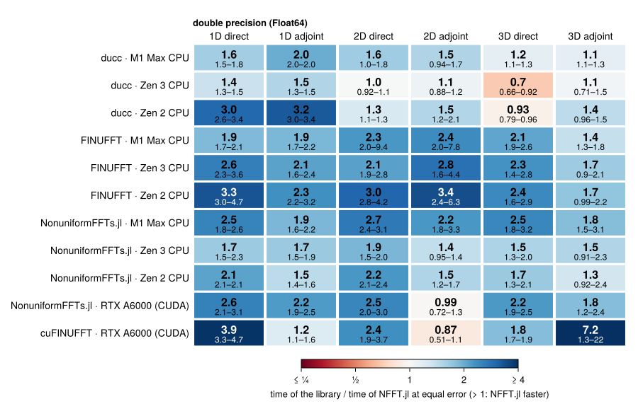
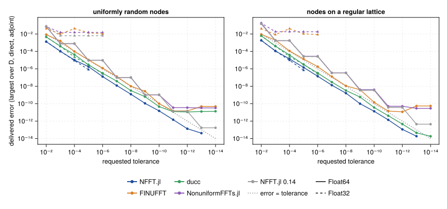
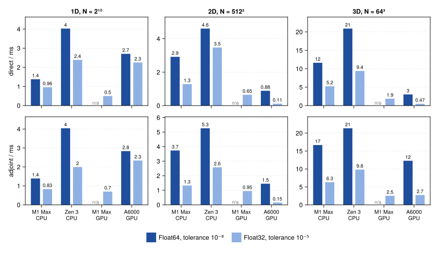

# Performance

NFFT.jl is compared with [FINUFFT](https://github.com/flatironinstitute/finufft),
[ducc](https://gitlab.mpcdf.mpg.de/mtr/ducc) and [NonuniformFFTs.jl](https://github.com/jipolanco/NonuniformFFTs.jl)
on CPUs, with [cuFINUFFT](https://finufft.readthedocs.io/en/latest/c_gpu.html) and NonuniformFFTs.jl
on an Nvidia GPU and with [mlx-nufft](https://github.com/martinlachaine/mlx-nufft) on an Apple GPU.
All numbers on this page come from the benchmark suite in `benchmark/` of the repository and can be
reproduced with it (see [Reproducing](@ref)).

| Platform | Machine | Other libraries | Data |
|:--|:--|:--|:--|
| M1 Max CPU | Apple M1 Max, 8 threads (performance cores), Julia 1.13.2 | FINUFFT and ducc built from their main branches with native CPU flags, NonuniformFFTs.jl | 2026-10-31, `run lite` |
| M1 Max GPU | the same machine, Metal.jl 1.12 | mlx-nufft 0.3.3 (Python, MLX) | 2026-10-29, `run metal` |
| Zen 3 CPU | AMD EPYC 7763 (Zen 3, AVX2), 8 threads, Julia 1.13.3 | FINUFFT 2.5.1 (release binary), ducc0 0.42 built with `-march=native`, NonuniformFFTs.jl 0.9.8 | 2026-10-31, `run lite`, provisional |
| A6000 GPU | Nvidia RTX A6000 (Ampere) in the same machine, CUDA.jl 6.5 | cuFINUFFT 2.5.1 (Python, CuPy 14.2), NonuniformFFTs.jl 0.9.8 | 2026-10-31, `run cuda`, provisional |

FFTW plans use `ESTIMATE`. Every library runs with its default options apart from the tolerance and
the number of threads (cuFINUFFT chooses its own method and sorts the nodes). Unless stated
otherwise ``J = |\bm{N}|`` uniformly random nodes, ``\bm{N} = 2^{18}``, ``512^2``, ``64^3``.
NonuniformFFTs.jl has no tolerance parameter; its kernel width is derived from the tolerance as in
NFFT.jl 0.14. The M1 Max CPU is the reference machine of this page. The Zen 3 and A6000 numbers are
provisional: they come from one lite run (one size per dimension, two rounds) on a shared machine
with other jobs running (load ≈ 35–45 on 256 hardware threads), where single timings can be off by
tens of percent, and the CUDA code of NFFT.jl has changed since.

**How to read the figures.** The libraries interpret their tolerance parameters differently, so they
are compared at equal *measured* error: for each measurement of another library, its time divided
by the time NFFT.jl needs for the same error (NFFT.jl's time interpolated between its own
measurements at neighbouring tolerances). Above 1 NFFT.jl is faster, below 1 the other library.
Absolute times are in the [Explorer](@ref).

## Overview



Each cell is the median of the speed ratios over the tolerance sweep (``10^{-2}`` to ``10^{-14}``
in double, ``10^{-2}`` to ``10^{-6}`` in single precision) for one library, platform, dimension and
transform; the small numbers are the smallest and the largest ratio. Only the Pareto front of each
library counts: the fastest time for each error it reaches, over all its tolerances. Blue: NFFT.jl
faster; red: the other library faster. "No overlap": the errors the two libraries reach do not
overlap, so no ratio exists; "1 point": only one measurement lies in the common error range (the
lite runs have three single-precision tolerances for the other libraries). mlx-nufft computes in
single precision only.

- **Double precision.** On both CPUs NFFT.jl is faster than FINUFFT (medians 1.4–2.8) and
  NonuniformFFTs.jl (1.4–1.9). ducc is the closest competitor: medians 1.0–2.2 on the M1 Max; on
  Zen 3 1.4–1.5 in 1D, 1.0–1.1 in 2D and 0.70 in the 3D direct transform (range 0.66–0.92). On the
  A6000 cuFINUFFT is ahead in the 2D adjoint (0.87, range 0.51–1.1) and behind elsewhere, in the 3D
  adjoint by up to 22×.
- **Single precision.** In 1D with ``N = 2^{18}`` FINUFFT, NonuniformFFTs.jl and cuFINUFFT do not
  get below an error of ``8 \cdot 10^{-3}`` to ``1.5 \cdot 10^{-2}``, while NFFT.jl's largest error is
  ``1.3 \cdot 10^{-3}`` (CPU) and ``2.8 \cdot 10^{-3}`` (CUDA). On the CPU part of this comes from the
  benchmark: the adapters of FINUFFT and NonuniformFFTs.jl pass the nodes as ``2\pi \bm{k}_j``
  rounded to single precision and measure against ``\bm{k}_j``. On the M1 Max GPU the medians against
  mlx-nufft are 0.86–1.1 in the direct transforms; its 1D and 2D adjoint are faster (0.69, 0.87).

## Delivered error

A tolerance is only comparable if it is kept. The suite `contract` measures the error each library
delivers for the tolerance it was given, over the sweep above, in double and single precision, for
uniformly random nodes and for nodes on a regular lattice, where the aliasing errors of the window
add up coherently (M1 Max CPU, 2026-10-31).



Each point is the largest error over the dimensions and over the direct and the adjoint transform;
dotted: error equal to the tolerance. NFFT.jl promises an error of at most `reltol` for any nodes,
or an `ArgumentError` if no parameters reach it (see [Accuracy and Parameters](@ref)); it never
exceeded the tolerance, for either node distribution, and rejected the tolerances below its
rounding floor (missing points). Each of the other libraries exceeded its tolerance in some cases:
ducc in a few, FINUFFT in about half, NonuniformFFTs.jl and NFFT.jl 0.14 in most, and these two in
every case with lattice nodes. The single-precision errors of FINUFFT and NonuniformFFTs.jl around
``10^{-2}`` are those of the 1D transform with ``N = 2^{18}`` and include the rounding of the nodes
described in the [Overview](@ref).

## CPU

The figures and the text of this section are for the M1 Max; the selector switches the figures to
the Zen 3 machine (the subsection [Zen 3](@ref) summarises them).

```@raw html
<div class="nfft-machine-switch" data-figures="accuracy density sizes threads batch real nnfft"
     data-machines='{"": "Apple M1 Max", "amd-epyc-7763": "AMD EPYC 7763 (Zen 3)"}'></div>
```

The first three figures show the speed ratio against one parameter each: accuracy, node density,
problem size; columns are the dimensions, rows the direct and the adjoint transform.

### Accuracy

Tolerance sweep from ``10^{-2}`` to ``10^{-14}``; solid: double precision, dashed: single precision
(``10^{-2}`` to ``10^{-6}``).


- **1D**: NFFT.jl is 1.5–2.3× faster than ducc and 1.2–2.1× faster than NonuniformFFTs.jl at every
  accuracy, 1.2–1.4× faster than ducc in single precision. FINUFFT is 1.5–2.4× slower, except at its
  accuracy limit around ``10^{-11}``, where it comes within 5 %.
- **2D and 3D**: ducc is the closest competitor. NFFT.jl is ahead by 1.1–1.4× at low and medium
  accuracy; from about ``10^{-11}`` on the two are within 10 % of each other, and ducc is ahead in
  the 3D direct transform at ``10^{-13}`` (5 %). FINUFFT is 1.1–5.3× slower, at single tolerances in
  2D up to 12×; NonuniformFFTs.jl 1.3–2.7×.
- **Single precision**: NFFT.jl is ahead of ducc by 1.3–1.8× in 2D and 3D.

### Node density

Nodes per mode ``J/|\bm{N}|`` from 0.01 to 100 at a tolerance of ``10^{-8}``; ``\bm{N}`` as in the
figures above for ``J/|\bm{N}| \geq 1`` (``2^{16}``, ``256^2``, ``32^3``) and four times larger
below (``2^{20}``, ``1024^2``, ``64^3``).


At low density the FFT dominates; NFFT.jl's pruned FFT passes make it 1.2–2.8× faster than ducc and
1.7–5.1× faster than FINUFFT. With growing density the resampling dominates and the gap narrows: at 100
nodes per mode ducc is faster in the 1D direct transform (9 %) and in 3D (5 % direct, 14 % adjoint);
FINUFFT stays behind in all cases.

### Problem size

``J = |\bm{N}|`` from ``10^3`` to about ``4 \cdot 10^6``, tolerance ``10^{-8}``.


For small problems the cost of starting and waking threads dominates; NFFT.jl runs each stage of
a small transform on only as many tasks as its work pays for. At ``|\bm{N}| = 10^3`` it is 1.7–2.6×
faster than ducc and 3–25× faster than FINUFFT. Around ``1.6 \cdot 10^4`` (1D ``2^{14}``, 2D
``128^2``) ducc is 4–5 % faster in the direct transform; at all other sizes NFFT.jl is ahead, in 3D by
1.05–1.8×.

### Threads

Speedup over one thread at a tolerance of ``10^{-8}`` (solid: direct, dashed: adjoint; dotted:
ideal).


With 8 threads NFFT.jl reaches a speedup of 4.9–5.2 in 1D and 6.5–7.0 in 2D and 3D. ducc reaches
3.4–3.5 in 1D and 6.0–6.7 in 2D and 3D, FINUFFT 2.9–3.5 in 1D and 4.5–5.5 in 2D and 3D.

### Many transforms with the same nodes

Time per transform for ``L`` transforms with the same nodes (`dims`, FINUFFT's `ntrans`; ducc
loops over the transforms), tolerance ``10^{-8}``.


Transforms with the same nodes share the window evaluation. For many short 1D transforms (OCT:
512 A-scans) NFFT.jl runs the transforms in parallel on single-threaded copies of the plan and
needs 7 µs per transform, 8–19× less than FINUFFT and ducc; a single A-scan takes 38 µs, 1.6–2×
less than ducc. For multi-coil MRI NFFT.jl is 1.3–1.4× faster than FINUFFT and 2.0–2.2× faster
than ducc; for volumes it gains nothing from batching and stays 5–10 % ahead of ducc.

### Real data

The RNFFT (real values at the nodes), the NFCT and the NFST against the complex NFFT of the same
size, tolerance ``10^{-8}``.


The RNFFT computes on a real grid and needs 62–77 % of the time of the complex NFFT. NFCT and NFST
cost 0.83–1.10× the complex NFFT in 2D and 3D; in 1D they are 1.4–1.5× slower.

### Non-equidistant in both domains (NNFFT)

The NNFFT (FINUFFT's type 3) maps values at arbitrary sources ``\bm{y}_l`` to arbitrary targets
``\bm{k}_j``. Here ``|\bm{N}|`` sources uniformly random in ``\prod_d [-N_d/2, N_d/2)`` and as many
targets in ``[-1/2, 1/2)^D``, the space-frequency extent of an NFFT of size ``\bm{N}`` (``2^{16}``,
``256^2``, ``32^3``); tolerance sweep, solid: double, dashed: single precision.


NFFT.jl is up to 1.7× faster than FINUFFT, and 8× at the highest accuracy in 2D; in 3D around
``10^{-4}`` FINUFFT's adjoint is 10 % faster. NFFT.jl computes grid
positions and phases in double precision also for single-precision data; with the large coordinates
of the type 3 this matters: in single precision FINUFFT stays at an error of ``10^{-2}`` in 1D and
needs 2.1–2.5× longer for errors around ``10^{-5}`` in 3D. Around ``10^{-4}`` in 3D single precision
FINUFFT is on par in the direct and 15 % faster in the adjoint transform.

### Zen 3

AMD EPYC 7763 with 8 threads, provisional (see the setup at the top). The accuracy figure of this
machine; the others with the selector at the top of this section.


Against FINUFFT and NonuniformFFTs.jl the picture of the M1 Max holds: medians 1.7–2.8 and 1.4–1.9
in double precision, single measurements down to 0.9. Against ducc it shifts: ratios 1.3–1.5 in 1D
and 0.88–1.2 in 2D; in 3D ducc's direct transform is 1.1–1.5× faster (ratios 0.66–0.92), and its
adjoint below ``10^{-10}`` up to 1.4× (ratios down to 0.71). In the density sweep NFFT.jl leads at
low density; at 100 nodes per mode ducc's direct transform is faster in all three dimensions (3D:
ratio 0.58), and so is its 3D adjoint.

## On GPUs

NFFT.jl runs on GPUs from the same code base (see [GPU](@ref) and [How NFFT.jl Works](@ref "GPUs")).
The data are on the device; plan and node setup are not timed; the GPU is synchronised after every
call.

### CUDA

Time against measured error on the RTX A6000, the Pareto front of each library; solid: double,
dashed: single precision. The A6000 has 1/32 of its single-precision throughput in double
precision. NFFT.jl ran at a revision with the unrolled interpolation kernel, before the subproblem
adjoint in double precision. cuFINUFFT runs from Python and is timed with CuPy, the others through
the Julia benchmark worker.


Where a line ends, the library reaches no smaller error. In single precision and 1D cuFINUFFT stays
at ``8.6 \cdot 10^{-3}`` and NonuniformFFTs.jl at ``1.5 \cdot 10^{-2}``; NFFT.jl reaches
``1.6 \cdot 10^{-6}``: it computes grid positions in double precision during planning. In double
precision NonuniformFFTs.jl 0.9.8 on CUDA does not get below ``7 \cdot 10^{-6}`` (1D) to
``1.3 \cdot 10^{-5}`` (3D), and its error grows again for smaller tolerances, up to
``3.5 \cdot 10^{-5}`` in 3D; on the CPU the same sweep gives errors down to ``3 \cdot 10^{-11}``
(1D) and ``4 \cdot 10^{-13}`` (2D).


In double precision NFFT.jl is 3.3–4.7× faster than cuFINUFFT in the 1D direct transform, 1.9–3.7×
in 2D and 1.7–1.9× in 3D; in the adjoint 1.1–1.6× in 1D and 1.3–22× in 3D, the more the higher the
accuracy. cuFINUFFT's 2D adjoint is up to 2× faster at low accuracy (ratios 0.51–1.1). In single
precision NFFT.jl is 2.0–18× faster than cuFINUFFT in 2D and 3D. Against NonuniformFFTs.jl the
ratios are 1.2–3.1 in double and 1.6–15 in single precision, except its 2D adjoint in double
precision (0.72–1.3).

For the large sizes ``2^{22}``, ``2048^2``, ``160^3`` the ratios to cuFINUFFT are closer to 1 in
1D and 2D: 0.91–1.1 in 1D, 1.1–1.4 in the 2D direct and 0.57–1.1 in the 2D adjoint transform; in
3D 1.1–1.6 (direct) and 1.4–21 (adjoint).


### Metal

Apple M1 Max GPU, single precision, tolerances ``10^{-2}`` to ``10^{-5}``: time against measured
error, Pareto fronts.


mlx-nufft uses the same subproblem scheme for the adjoint (see
[How NFFT.jl Works](@ref "GPUs")). Its 1D error stays at ``2.3 \cdot 10^{-3}`` for ``N = 2^{18}``.
At equal error NFFT.jl's direct transform is 1.0–1.2× faster in 1D and 2D, mlx-nufft's up to 1.18×
in 3D (ratios 0.85–1.0); mlx-nufft's adjoint is 1.1–1.45× faster in 1D and 2D (ratios 0.69–0.89),
in 3D the adjoints are within 10 %.

Apple M1 Max (Metal, single precision, ``2^{18}`` nodes, tolerance ``10^{-4}``) against the CPU
with 8 threads, ms (direct / adjoint; fastest of repeated runs into preallocated outputs, the GPU
synchronised after each):

| | CPU | GPU |
|:--|--:|--:|
| NFFT, 1D ``2^{18}`` | 0.9 / 0.8 | 0.5 / 0.7 |
| NFFT, 2D ``512^2`` | 1.3 / 1.3 | 0.7 / 0.9 |
| NFFT, 3D ``64^3`` | 3.1 / 3.6 | 1.0 / 1.6 |
| RNFFT, 3D | 2.9 / 2.6 | 1.0 / 1.3 |
| NFFT, OCT ``2048 \times 512`` | 2.4 / 2.4 | 1.0 / 1.5 |

Measurements on AMD GPUs are still missing.

### The same code on four devices

NFFT.jl's time for the standard cases on each device: double precision at a tolerance of
``10^{-8}``, single precision at ``10^{-5}``; CPUs with 8 threads. The M1 Max GPU has no double
precision. Zen 3 and A6000 provisional.



In single precision the A6000 needs 0.064–0.55 ms, 8–18× less than the M1 Max CPU; the M1 Max GPU
needs 0.5–2.5 ms, 1.5–2.6× less than its CPU. In double precision the A6000 is 1.3–3.3× faster
than the M1 Max CPU in 1D, 2D and the 3D direct transform, and about as fast in the 3D adjoint
(12 against 13 ms). The Zen 3 CPU needs 1.5–2.4× the time of the M1 Max CPU.

## Parameters or implementation

A speed ratio between two libraries mixes the parameters each one chooses (window, ``W``, grid) with
the implementation. The suite `decomposition` separates the two: NFFT.jl also runs with the
parameters the other library would choose (expert options `window = CustomWindow(…)` and
`gridsize`), so that the ratio splits into a parameter factor and an implementation factor. FFT
planning counts as implementation: every library plans with its own default flag; the suite
`fftflags` shows what `ESTIMATE` and `MEASURE` change for the other libraries. Which technique
accounts for how much of NFFT.jl's own speed can be measured with the ablation switches described
in [How NFFT.jl Works](@ref "Measuring the techniques").

## Further measurements

The [Explorer](@ref) also holds measurements without a figure of their own:

- **Node distributions** (suite `nodes`): uniform, radial spokes through the centre (as in MRI)
  and nodes clustered in the centre (normal distribution) change the time of each library by less
  than 15 %.
- **NFFT.jl 0.14** (suite `history`): at the same requested tolerance NFFT.jl 1.0 is up to 4.8×
  faster in the direct and up to 14× faster in the adjoint transform (2D with 8 threads, where 0.14
  used FFTW's slow threaded `ESTIMATE` plans); 0.14 misses its tolerance by a factor of 3–4, so at
  equal error the factors are larger.

## Explorer

All measurements of this page. Choose the machine, a suite, the quantity on the y axis and the
parameters; hovering a point shows the details (including the window width ``W`` and oversampling
factor ``σ`` NFFT.jl chose).

```@raw html
<div id="nfft-explorer"></div>
```

## Reproducing

```
julia benchmark/bench.jl run fast                  # ≈ 15 s, NFFT.jl alone
julia benchmark/bench.jl run quick                 # ≈ 1 min, NFFT.jl, FINUFFT and ducc
julia benchmark/bench.jl run all --save            # all suites of this page
julia benchmark/bench.jl run lite --save           # the figures with every other point, ≈ 10 min
julia benchmark/bench.jl report                    # figures and explorer data
julia benchmark/bench.jl run contract              # delivered error against the tolerance
julia benchmark/bench.jl run metal                 # Apple GPU, with mlx-nufft
julia benchmark/bench.jl run cuda                  # Nvidia GPU; cuFINUFFT: benchmark/cufinufft.py
julia benchmark/bench.jl run decomposition         # parameter and implementation factors
julia benchmark/bench.jl run fftflags              # the other libraries with ESTIMATE and MEASURE
julia benchmark/bench.jl ab v1.0.0                 # the working tree against a release
```

Each library runs in its own process and environment, with its default parameters apart from
the tolerance and the number of threads. The error is the relative ``\ell^2`` error against the
exact NDFT on 64 sampled outputs, the time the minimum over repeated calls of a precomputed plan.
The results of each machine are in `benchmark/results/<machine>/`; details in `benchmark/README.md`.
