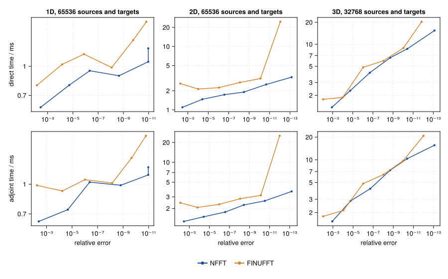
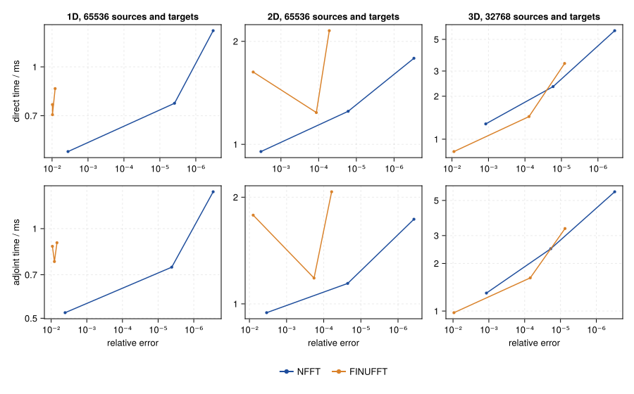

# Performance

NFFT.jl is compared with [FINUFFT](https://github.com/flatironinstitute/finufft),
[ducc](https://gitlab.mpcdf.mpg.de/mtr/ducc), [NonuniformFFTs.jl](https://github.com/jipolanco/NonuniformFFTs.jl)
and its previous version 0.14. All numbers on this page come from the benchmark suite in
`benchmark/` of the repository and can be reproduced with it (see [Reproducing](@ref)).

Setup of the figures: Apple M1 Max, 8 threads (performance cores), Julia 1.13; FINUFFT and ducc
built from their main branches with native CPU flags; FFTW plans with `ESTIMATE`. Unless stated
otherwise ``J = |\bm{N}| = 2^{18}`` uniformly random nodes, ``\bm{N} = 2^{18}``, ``512^2``,
``64^3``, double precision. NonuniformFFTs.jl has no tolerance parameter; its kernel width is
derived from the tolerance as in NFFT.jl 0.14.

## Time against accuracy

The libraries interpret their tolerance parameters differently, so they are compared at equal
*measured* error. Each point is one tolerance of a sweep from ``10^{-2}`` to ``10^{-14}``
(single precision: ``10^{-6}``); further right means more accurate, lower means faster.


- **1D**: NFFT.jl is the fastest library at every accuracy, 1.3–2× ahead of ducc, FINUFFT and
  NonuniformFFTs.jl in the direct transform and 1.2–2.8× in the adjoint.
- **2D**: NFFT.jl is 1.1–1.6× faster than ducc (most at low accuracy) and on par at ``10^{-13}``;
  FINUFFT is 1.4–2.2× slower (more at some accuracies), NonuniformFFTs.jl 1.9–16×.
- **3D**: NFFT.jl is 1.3–1.7× faster than ducc up to ``10^{-6}`` and on par from ``10^{-8}`` on;
  FINUFFT and NonuniformFFTs.jl are 1.3–4.4× slower.


In single precision NFFT.jl is faster than ducc in every dimension, 1.1–1.4× in the direct
transform and 1.2–2× in the adjoint. FINUFFT cannot reach
small errors in single precision for these sizes (its tolerance floor grows with ``N``; in 1D it
rejects even ``10^{-2}``).

## Delivered error

A tolerance is only comparable if it is kept. The suite `contract` measures the error each library
delivers for the tolerance it was given, over the sweep above, in double and single precision, for
uniformly random nodes and for nodes on a regular lattice, where the aliasing errors of the window
add up coherently. NFFT.jl promises an error of at most `reltol` for any nodes, or an
`ArgumentError` if no parameters reach it (see [Accuracy and Parameters](@ref)); in the contract run
of 2026-10-31 it never exceeded the tolerance, for either node distribution, and rejected the
tolerances below its rounding floor. Each of the other libraries exceeded its tolerance in some
cases: ducc in a few, FINUFFT in about half, NonuniformFFTs.jl and NFFT.jl 0.14 in most, and these
two in every case with lattice nodes.

## Parameters or implementation

A speed ratio between two libraries mixes the parameters each one chooses (window, ``W``, grid) with
the implementation. The suite `decomposition` separates the two: NFFT.jl also runs with the
parameters the other library would choose (expert options `window = CustomWindow(…)` and
`gridsize`), so that the ratio splits into a parameter factor and an implementation factor. FFT
planning counts as implementation: every library plans with its own default flag; the suite
`fftflags` shows what `ESTIMATE` and `MEASURE` change for the other libraries. Which technique
accounts for how much of NFFT.jl's own speed can be measured with the ablation switches described
in [How NFFT.jl Works](@ref "Measuring the techniques").

## Threads

Speedup over one thread at a tolerance of ``10^{-8}`` (solid: direct, dashed: adjoint; dotted:
ideal).


With 8 threads NFFT.jl reaches a speedup of 4.6–5.0 in 1D, 6.0–6.2 in 2D and 6.6–6.7 in 3D. ducc
scales similarly in 2D and 3D (5.5–6.4), FINUFFT less (3.6–5.3); in 1D both reach 2.9–3.4.

## Problem size

Time per node for ``J = |\bm{N}|`` uniformly random nodes at a tolerance of ``10^{-8}``.


For large problems the time per node is 6–9 ns in 1D, 9–12 ns in 2D and about 36 ns (direct) and
50 ns (adjoint) in 3D. Below about ``10^4`` nodes the fixed costs of the threaded stages dominate;
there NFFT.jl is slower than ducc in 1D and 2D, while in 3D it stays ahead.

## Node distributions

Uniformly random nodes, radial spokes through the centre (as in MRI) and nodes clustered in the
centre (normal distribution), tolerance ``10^{-8}``. Solid bars: direct transform, light bars:
adjoint.


The distribution of the nodes hardly matters for any of the libraries.

## Many transforms with the same nodes

Time per transform for ``L`` transforms with the same nodes (`dims`, FINUFFT's `ntrans`; ducc
loops over the transforms), tolerance ``10^{-8}``.


Transforms with the same nodes share the window evaluation. For many short 1D transforms (OCT:
512 A-scans) NFFT.jl runs the transforms in parallel on single-threaded copies of the plan and
needs 7 µs per transform, 7–20× less than FINUFFT and ducc. For multi-coil MRI it is 1.2–2.2×
faster than the others, for volumes 5–14 % faster than ducc.

## Real data

The RNFFT (real values at the nodes), the NFCT and the NFST against the complex NFFT of the same
size, tolerance ``10^{-8}``.


The RNFFT computes on a real grid. At ``10^{-8}`` its adjoint needs about 65 % of the time of the
complex NFFT and its direct transform 65–75 % (in 2D as much as the complex NFFT); in 1D at
``10^{-4}`` it is slower than the complex NFFT. NFCT and NFST cost about as much as the complex NFFT
in 2D and 3D; in 1D they are still slower.

## Non-equidistant in both domains (NNFFT)

The NNFFT (FINUFFT's type 3) maps values at arbitrary sources ``\bm{y}_l`` to arbitrary targets
``\bm{k}_j``. Here ``|\bm{N}|`` sources uniformly random in ``\prod_d [-N_d/2, N_d/2)`` and as many
targets in ``[-1/2, 1/2)^D``, the space-frequency extent of an NFFT of size ``\bm{N}`` (``2^{16}``,
``256^2``, ``32^3``); tolerance sweep as above.



In double precision NFFT.jl is faster than FINUFFT in 1D (up to 1.4×) and 2D (1.3–2×); in 3D the
two are on par around ``10^{-4}`` and NFFT.jl is up to 1.4× ahead at the other accuracies. At the
highest accuracy the difference is large: in 2D NFFT.jl reaches ``7·10^{-14}`` in 3.3 ms, FINUFFT
``9·10^{-13}`` in 25 ms. Planning takes 4–9 ms in NFFT.jl and 4–6 ms in FINUFFT (more at its
accuracy limits).



NFFT.jl computes grid positions and phases in double precision also for single-precision data. With
the large coordinates of the type 3 this matters: NFFT.jl reaches ``3·10^{-7}`` in 1D, 2D and 3D,
where FINUFFT stays at ``10^{-2}`` (1D), ``5·10^{-5}`` (2D) and ``8·10^{-6}`` (3D). At equal error
NFFT.jl is also faster, except for the 3D adjoint around ``10^{-4}``.

## On GPUs

Apple M1 Max (Metal, single precision, ``2^{18}`` nodes, tolerance ``10^{-4}``) against the CPU
with 8 threads, ms (direct / adjoint; fastest of repeated runs into preallocated outputs, the GPU
synchronised after each):

| | CPU | GPU |
|:--|--:|--:|
| NFFT, 1D ``2^{18}`` | 0.9 / 0.8 | 0.5 / 0.7 |
| NFFT, 2D ``512^2`` | 1.3 / 1.3 | 0.7 / 0.9 |
| NFFT, 3D ``64^3`` | 3.1 / 3.6 | 1.0 / 1.6 |
| RNFFT, 3D | 2.9 / 2.6 | 1.0 / 1.3 |
| NFFT, OCT ``2048 \times 512`` | 2.4 / 2.4 | 1.0 / 1.5 |

[mlx-nufft](https://github.com/martinlachaine/mlx-nufft), with the same subproblem scheme (see
[How NFFT.jl Works](@ref "GPUs")), takes 0.6 / 0.4, 0.6 / 0.7 and 0.9 / 1.7 ms for the first
three rows, at errors 2 to 40 times larger than NFFT.jl's for the same tolerance (`run metal` of the
benchmark suite). Measurements on Nvidia and AMD GPUs are still missing.

## NFFT.jl 1.0 against 0.14


Speedup of NFFT.jl 1.0 over 0.14 at the same requested tolerance, with 1 thread (dashed) and
8 threads (solid). NFFT.jl 0.14 misses its tolerance by a factor of 3–4 (e.g. ``3.5·10^{-4}`` for
``10^{-4}``), so at equal error the speedups are larger. The large factors in 2D with 8 threads
come from FFTW's slow threaded `ESTIMATE` plans that 0.14 used.

## Explorer

All measurements of this page. Choose a suite, the quantity on the y axis and the parameters;
hovering a point shows the details (including the window width ``W`` and oversampling factor
``σ`` NFFT.jl chose).

```@raw html
<div id="nfft-explorer"></div>
```

## Reproducing

```
julia benchmark/bench.jl run fast                  # ≈ 15 s, NFFT.jl alone
julia benchmark/bench.jl run quick                 # ≈ 1 min, NFFT.jl, FINUFFT and ducc
julia benchmark/bench.jl run all --save            # all suites of this page, ≈ 15 min
julia benchmark/bench.jl report                    # figures and explorer data
julia benchmark/bench.jl run contract              # delivered error against the tolerance
julia benchmark/bench.jl run decomposition         # parameter and implementation factors
julia benchmark/bench.jl run fftflags              # the other libraries with ESTIMATE and MEASURE
julia benchmark/bench.jl ab v1.0.0                 # the working tree against a release
```

Each library runs in its own process and environment, with its default parameters apart from
the tolerance and the number of threads. The error is the relative ``\ell^2`` error against the
exact NDFT on 64 sampled outputs, the time the minimum over repeated calls of a precomputed plan.
Details in `benchmark/README.md`.
