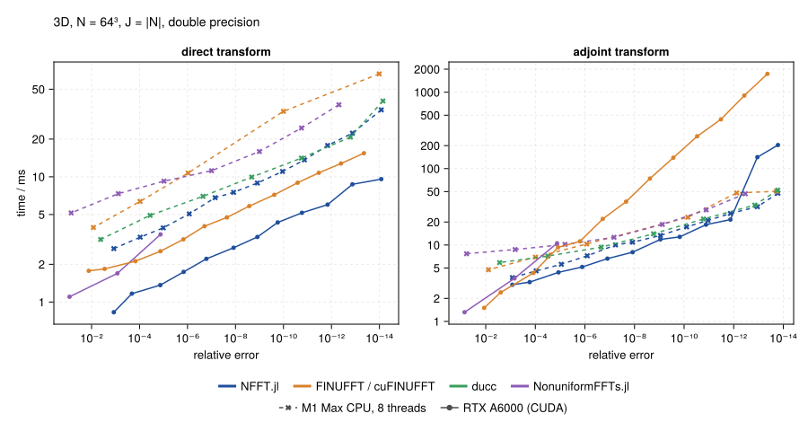

# Performance

NFFT.jl is compared with [FINUFFT](https://github.com/flatironinstitute/finufft),
[ducc](https://gitlab.mpcdf.mpg.de/mtr/ducc) and [NonuniformFFTs.jl](https://github.com/jipolanco/NonuniformFFTs.jl)
on CPUs, with [cuFINUFFT](https://finufft.readthedocs.io/en/latest/c_gpu.html) and NonuniformFFTs.jl
on an Nvidia GPU and with [mlx-nufft](https://github.com/martinlachaine/mlx-nufft) on an Apple GPU.
All numbers come from the benchmark suite in `benchmark/` of the repository and can be reproduced
with it (see [Reproducing](@ref)). This page shows four figures; the CPU suites (node density,
problem size, threads, batches, real data, NNFFT), single precision, the GPU comparisons in detail
and all measurements are on the page [Benchmark details](@ref).

| Platform | Machine | Other libraries | Data |
|:--|:--|:--|:--|
| M1 Max CPU | Apple M1 Max, 8 threads (performance cores), Julia 1.13.2 | FINUFFT and ducc built from their main branches with native CPU flags, NonuniformFFTs.jl | 2026-10-31, `run lite` |
| M1 Max GPU | the same machine, Metal.jl 1.12 | mlx-nufft 0.3.3 (Python, MLX) | 2026-10-29, `run metal` |
| Zen 3 CPU | AMD EPYC 7763 (Zen 3, AVX2), 8 threads, Julia 1.13.3 | FINUFFT 2.5.1 (release binary), ducc0 0.42 built with `-march=native`, NonuniformFFTs.jl 0.9.8 | 2026-10-31, `run lite`, provisional |
| A6000 GPU | Nvidia RTX A6000 (Ampere) in the same machine, CUDA.jl 6.5 | cuFINUFFT 2.5.1 (Python, CuPy 14.2), NonuniformFFTs.jl 0.9.8 | 2026-10-31, `run cuda`, provisional |

Unless stated otherwise ``J = |\bm{N}|`` uniformly random nodes, ``\bm{N} = 2^{18}``, ``512^2``,
``64^3``. How the times and errors are measured is described [below](@ref "How the benchmarks measure").

## Time against error

3D, ``\bm{N} = 64^3``, double precision: time against measured error of each library on the M1 Max
CPU (dashed, crosses) and on the A6000 GPU (solid, circles); for each library the fastest time for
each error it reaches. The Zen 3 CPU is left out of this figure for readability; its curves are on
the [Benchmark details](@ref "Zen 3") page.

On the M1 Max CPU ducc needs 1.1–1.2× the time of NFFT.jl in 3D (medians, overview below), FINUFFT
and NonuniformFFTs.jl 1.1–3.0×. On the A6000 cuFINUFFT's adjoint grows from 1.5 ms at an error of
``1.2 \cdot 10^{-2}`` to 1.7 s at ``4.4 \cdot 10^{-14}``; NFFT.jl's from 3.0 ms at
``8.4 \cdot 10^{-4}`` to 203 ms at ``1.6 \cdot 10^{-14}``, with a step from 22 to 141 ms between
``1.4 \cdot 10^{-12}`` and ``1.1 \cdot 10^{-13}`` (window width 12 to 13). NonuniformFFTs.jl on
CUDA reaches no error below ``1.3 \cdot 10^{-5}``.

## Overview

Each cell is the time of the other library divided by the time NFFT.jl needs for the same measured
error (NFFT.jl's time interpolated between its own measurements at neighbouring tolerances), as the
median over the tolerance sweep ``10^{-2}`` to ``10^{-14}`` in double precision for one library,
platform, dimension and transform; the small numbers are the smallest and the largest ratio. Blue:
NFFT.jl faster; red: the other library faster.

On both CPUs NFFT.jl is faster than FINUFFT (medians 1.4–2.8) and NonuniformFFTs.jl (1.4–1.9). ducc
is the closest competitor: medians 1.0–2.2 on the M1 Max; on Zen 3 1.4–1.5 in 1D, 1.0–1.1 in 2D and
0.70 in the 3D direct transform (range 0.66–0.92). On the A6000 cuFINUFFT is ahead in the 2D
adjoint (0.87, range 0.51–1.1) and behind elsewhere, in the 3D adjoint by up to 22×. The same
overview in single precision, with mlx-nufft on the M1 Max GPU, is on the
[Benchmark details](@ref "Overview in single precision") page.

## Delivered error

A tolerance is only comparable if it is kept. The suite `contract` measures the error each library
delivers for the tolerance it was given, over the sweep above, in double and single precision, for
uniformly random nodes and for nodes on a regular lattice, where the aliasing errors of the window
add up coherently (M1 Max CPU, 2026-10-31).

Each point is the largest error over the dimensions and over the direct and the adjoint transform;
dotted: error equal to the tolerance. NFFT.jl promises an error of at most `reltol` for any nodes,
or an `ArgumentError` if no parameters reach it (see [Accuracy and Parameters](@ref)); it never
exceeded the tolerance, for either node distribution, and rejected the tolerances below its
rounding floor (missing points). Each of the other libraries exceeded its tolerance in some cases:
ducc in a few, FINUFFT in about half, NonuniformFFTs.jl and NFFT.jl 0.14 in most, and these two in
every case with lattice nodes. The single-precision errors of FINUFFT and NonuniformFFTs.jl around
``10^{-2}`` are those of the 1D transform with ``N = 2^{18}`` and include the rounding of the nodes
described [below](@ref "How the benchmarks measure").

## The same code on four devices

NFFT.jl's time for the standard cases on each device: double precision at a tolerance of
``10^{-8}``, single precision at ``10^{-5}``; CPUs with 8 threads. The M1 Max GPU has no double
precision. Zen 3 and A6000 provisional.

In single precision the A6000 needs 0.064–0.55 ms, 8–18× less than the M1 Max CPU; the M1 Max GPU
needs 0.5–2.5 ms, 1.5–2.6× less than its CPU. In double precision the A6000 is 1.3–3.3× faster
than the M1 Max CPU in 1D, 2D and the 3D direct transform, and about as fast in the 3D adjoint
(12 against 13 ms). The Zen 3 CPU needs 1.5–2.4× the time of the M1 Max CPU.

## How the benchmarks measure

- **Equal measured error.** The libraries interpret their tolerance parameters differently, so they
  are compared at equal measured error: the relative ``\ell^2`` error against the exact NDFT on 64
  sampled outputs. Each library sweeps its tolerance; a speed ratio interpolates NFFT.jl's time
  (log–log, between its neighbouring tolerances) at the error the other library delivers.
- **Pareto rule.** Only the fastest time for each error a library reaches counts, over all its
  tolerances; errors within 15 % of each other count as equal, and the faster point stays.
- **What is timed.** The execution of a precomputed plan: the minimum over repeated calls into
  preallocated outputs, on GPUs with a synchronisation after every call. Planning and the setup of
  the nodes are not timed. Benchmarks that include the setup of the nodes in every call measure a
  different use case, one where the nodes change between transforms.
- **Options of the other libraries.** Each library runs in its own process with its default options
  apart from the tolerance and the number of threads; FFTW plans use `ESTIMATE`; cuFINUFFT chooses
  its own method and sorts the nodes. NonuniformFFTs.jl has no tolerance parameter. Its half support
  ``m`` is set from the tolerance ``\varepsilon`` by the rule of NFFT.jl 0.14,
  ``m = \lfloor (\lceil \log_{10}(1/\varepsilon) \rceil + 1)/2 \rfloor``, with its default oversampling ``σ = 2``. This mapping is ours, not a rule
  of NonuniformFFTs.jl; a sweep over ``σ`` and ``m`` is pending.
- **Provisional data.** The Zen 3 and A6000 numbers come from one lite run (one size per dimension,
  two rounds) on a shared machine with other jobs running (load ≈ 35–45 on 256 hardware threads),
  where single timings can be off by tens of percent. The CUDA code of NFFT.jl has changed since.
- **Single precision.** The CPU adapters of FINUFFT and NonuniformFFTs.jl pass the nodes as
  ``2\pi \bm{k}_j`` rounded to single precision, while the error is measured against
  ``\bm{k}_j``; their single-precision errors include this rounding (to be fixed in the benchmark).
  ducc and NFFT.jl receive ``\bm{k}_j`` itself. cuFINUFFT was measured against the rounded nodes it
  receives.

Everything else, including the explorer with all measurements and the commands to reproduce them,
is on the page [Benchmark details](@ref).
