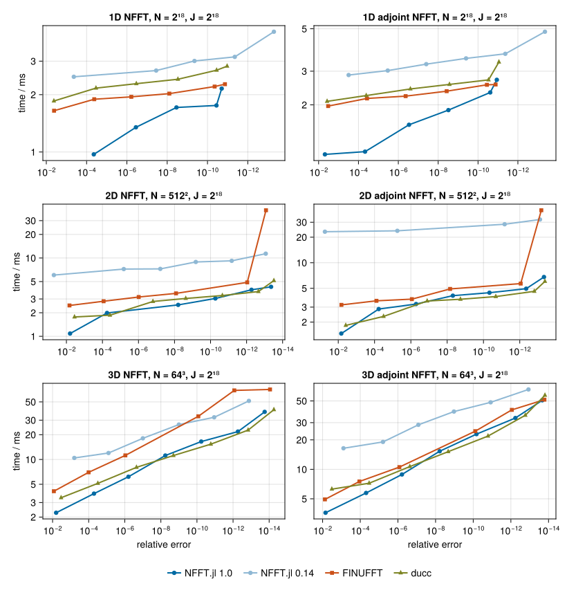

# Performance

The figure compares the run time of NFFT.jl with FINUFFT, ducc and the previous version NFFT.jl
0.14, plotted against the relative error each library actually reaches. Each point is one
tolerance of a sweep from ``10^{-2}`` to ``10^{-14}``; lower and further right is better.

Setup:
- ``J = 2^{18}`` uniformly random nodes; ``\bm{N} = (2^{18})``, ``(512, 512)`` and
  ``(64, 64, 64)``; double precision.
- Apple M1 Max, 8 threads, Julia 1.13. FINUFFT and ducc built from their main branches with
  native CPU flags. FFTW with `ESTIMATE` for all libraries that use FFTW.
- Error: relative ``\ell^2`` error against the NDFT on 64 sampled outputs. Time: minimum over
  repeated calls of a precomputed plan.

How to read it:
- **1D**: NFFT.jl is the fastest library at every accuracy, by a factor of about 1.3–2 for the
  NFFT and up to 2 for the adjoint.
- **2D**: NFFT.jl and ducc are close, both ahead of FINUFFT.
- **3D**: NFFT.jl and ducc are on par, FINUFFT is slower at medium and high accuracy.
- Compared with NFFT.jl 0.14 the new implementation is 2–6 times faster and reaches the
  requested accuracy reliably.

The libraries interpret their tolerance parameters differently, which is why the comparison is
made at equal measured error rather than at equal tolerance. The benchmark code lives outside the
package so that the libraries it compares against do not become dependencies.
