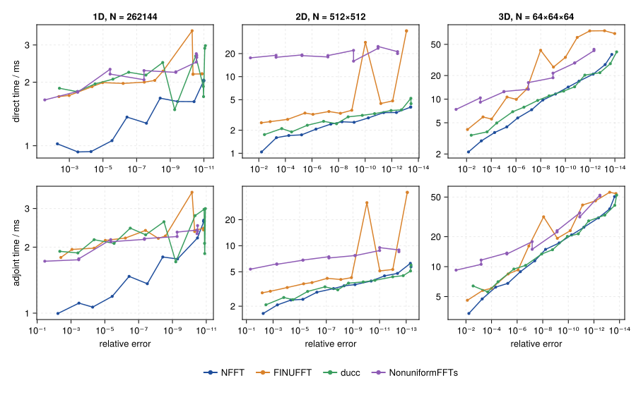
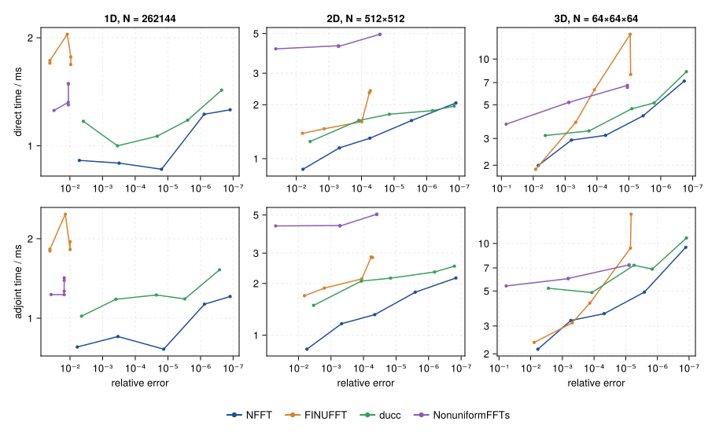
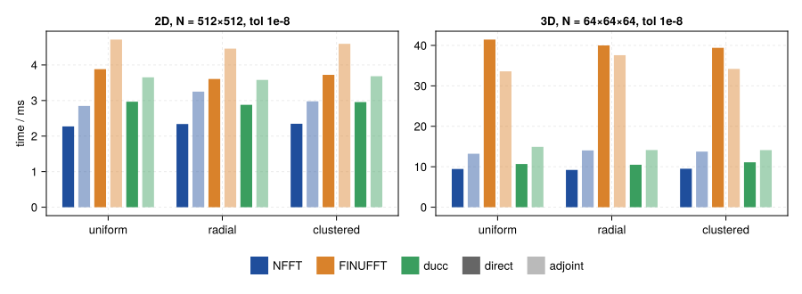
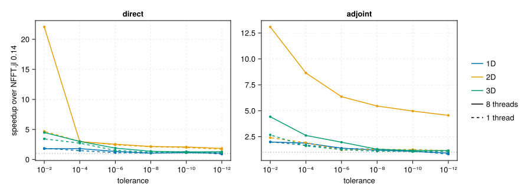

# Performance

NFFT.jl is compared with [FINUFFT](https://github.com/flatironinstitute/finufft),
[ducc](https://gitlab.mpcdf.mpg.de/mtr/ducc), [NonuniformFFTs.jl](https://github.com/jipolanco/NonuniformFFTs.jl)
and its previous version 0.14. All numbers on this page come from the benchmark suite in
`benchmark/` of the repository and can be reproduced with it (see [Reproducing](@ref)).

Setup of the figures: Apple M1 Max, 8 threads (performance cores), Julia 1.13; FINUFFT and ducc
built from their main branches with native CPU flags; FFTW plans with `ESTIMATE`. Unless stated
otherwise ``J = |\bm{N}| = 2^{18}`` uniformly random nodes, ``\bm{N} = 2^{18}``, ``512^2``,
``64^3``, double precision. NonuniformFFTs.jl has no tolerance parameter; its kernel width is
derived from the tolerance as in NFFT.jl 0.14.

## Time against accuracy

The libraries interpret their tolerance parameters differently, so they are compared at equal
*measured* error. Each point is one tolerance of a sweep from ``10^{-2}`` to ``10^{-14}``
(single precision: ``10^{-6}``); further right means more accurate, lower means faster.



- **1D**: NFFT.jl is the fastest library at every accuracy, 1.4–2× ahead of FINUFFT and ducc.
- **2D**: NFFT.jl and ducc are within 10 % of each other (NFFT.jl ahead at low accuracy), FINUFFT
  is 1.2–1.6× slower.
- **3D**: NFFT.jl and ducc are on par; FINUFFT is up to 4.5× slower for the direct transform.



In single precision NFFT.jl is 1.2–1.8× faster than ducc in every dimension. FINUFFT cannot reach
small errors in single precision for these sizes (its tolerance floor grows with ``N``; in 1D it
rejects even ``10^{-2}``).

## Threads

Speedup over one thread at a tolerance of ``10^{-8}`` (solid: direct, dashed: adjoint; dotted:
ideal).


With 8 threads NFFT.jl reaches a speedup of 4.4–4.7 in 1D, 5.7–6.2 in 2D and 6.3 in 3D; ducc and
FINUFFT scale similarly in 2D and 3D and less in 1D (3.2–3.6).

## Problem size

Time per node for ``J = |\bm{N}|`` uniformly random nodes at a tolerance of ``10^{-8}``.


For large problems the time per node is 7–10 ns in 1D and 2D and about 30 ns (direct) and 55 ns
(adjoint) in 3D. Below about ``10^4`` nodes the fixed costs of the threaded stages dominate; there
NFFT.jl is slower than ducc in 2D and 3D.

## Node distributions

Uniformly random nodes, radial spokes through the centre (as in MRI) and nodes clustered in the
centre (normal distribution), tolerance ``10^{-8}``. Solid bars: direct transform, light bars:
adjoint.



The distribution of the nodes hardly matters for any of the libraries.

## Many transforms with the same nodes

Time per transform for ``L`` transforms with the same nodes (`dims`, FINUFFT's `ntrans`; ducc
loops over the transforms), tolerance ``10^{-8}``.


Transforms with the same nodes share the window evaluation. For many short 1D transforms (OCT:
512 A-scans) NFFT.jl runs the transforms in parallel on single-threaded copies of the plan and
needs 7 µs per transform, 13–15× less than FINUFFT and ducc. For multi-coil MRI it is 1.1–2× faster
than the others, for volumes on par with ducc.

## Real data

The RNFFT (real values at the nodes), the NFCT and the NFST against the complex NFFT of the same
size, tolerance ``10^{-8}``.


The RNFFT computes on a real grid and needs about 60 % of the time of the complex NFFT. NFCT and
NFST cost about as much as the complex NFFT in 2D and 3D; in 1D they are still slower.

## NFFT.jl 1.0 against 0.14



Speedup of NFFT.jl 1.0 over 0.14 at the same requested tolerance, with 1 thread (dashed) and
8 threads (solid). NFFT.jl 0.14 misses its tolerance by a factor of 3–4 (e.g. ``3.5·10^{-4}`` for
``10^{-4}``), so at equal error the speedups are larger. The large factors in 2D with 8 threads
come from FFTW's slow threaded `ESTIMATE` plans that 0.14 used.

## Explorer

All measurements of this page. Choose a suite, the quantity on the y axis and the parameters;
hovering a point shows the details (including the window width ``W`` and oversampling factor
``σ`` NFFT.jl chose).

```@raw html
<div id="nfft-explorer"></div>
```

## Reproducing

```
julia benchmark/bench.jl run quick                 # ≈ 1 min, NFFT.jl, FINUFFT and ducc
julia benchmark/bench.jl run all --save            # all suites of this page, ≈ 30 min
julia benchmark/bench.jl report                    # figures and explorer data
julia benchmark/bench.jl ab v1.0.0                 # the working tree against a release
```

Each library runs in its own process and environment, with its default parameters apart from
the tolerance and the number of threads. The error is the relative ``\ell^2`` error against the
exact NDFT on 64 sampled outputs, the time the minimum over repeated calls of a precomputed plan.
Details in `benchmark/README.md`.
