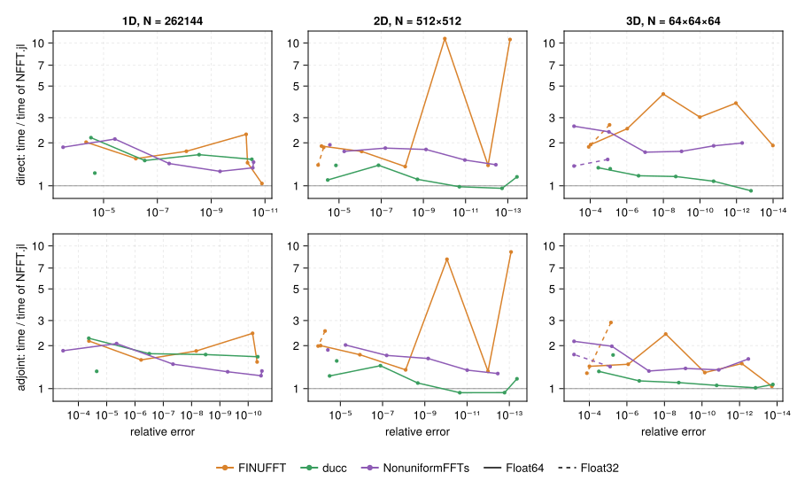
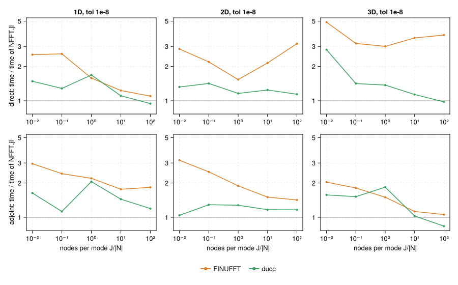
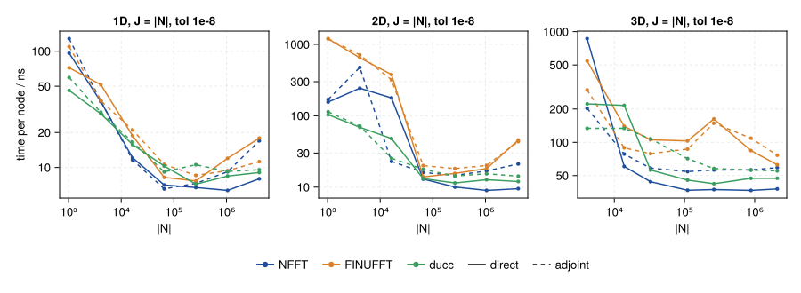
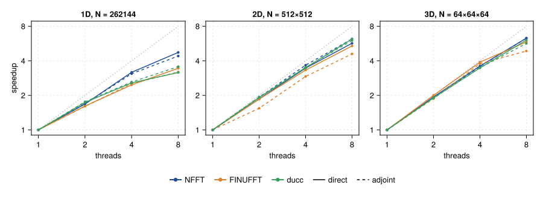
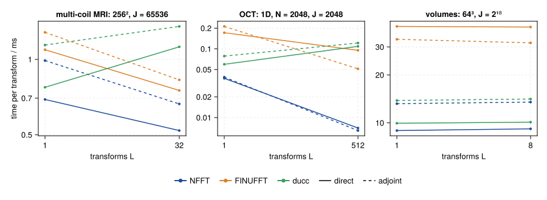
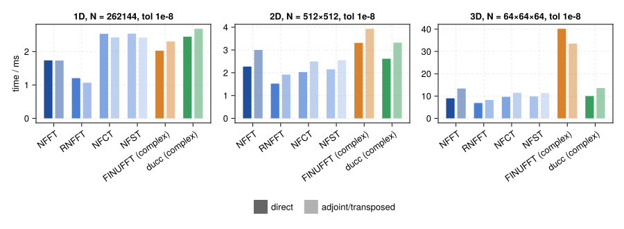
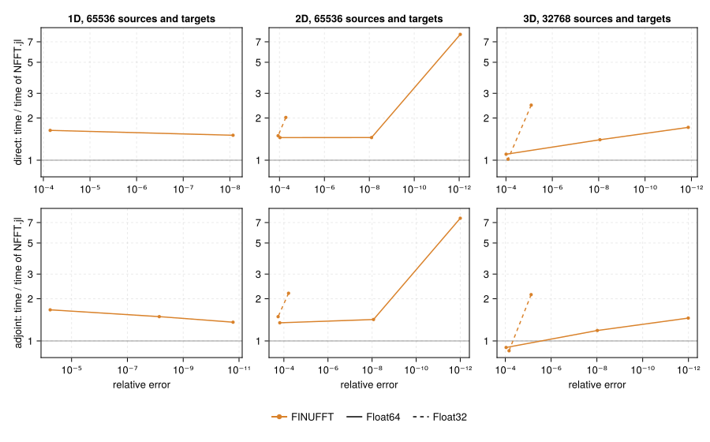

# Performance

NFFT.jl is compared with [FINUFFT](https://github.com/flatironinstitute/finufft),
[ducc](https://gitlab.mpcdf.mpg.de/mtr/ducc) and [NonuniformFFTs.jl](https://github.com/jipolanco/NonuniformFFTs.jl).
All numbers on this page come from the benchmark suite in `benchmark/` of the repository and can be
reproduced with it (see [Reproducing](@ref)).

Setup: Apple M1 Max, 8 threads (performance cores), Julia 1.13; FINUFFT and ducc built from their
main branches with native CPU flags; FFTW plans with `ESTIMATE`. Unless stated otherwise
``J = |\bm{N}|`` uniformly random nodes, ``\bm{N} = 2^{18}``, ``512^2``, ``64^3``, double precision.
NonuniformFFTs.jl has no tolerance parameter; its kernel width is derived from the tolerance as in
NFFT.jl 0.14.

**How to read the figures.** The libraries interpret their tolerance parameters differently, so they
are compared at equal *measured* error. The first four figures show, for each other library, its time
divided by the time NFFT.jl needs for the same error (NFFT.jl's time interpolated between its own
measurements at neighbouring tolerances). Above 1 NFFT.jl is faster, below 1 the other library. Each
figure varies one parameter: accuracy, node density, problem size; columns are the dimensions, rows
the direct and the adjoint transform. Absolute times are in the [Explorer](@ref).

## Accuracy

Tolerance sweep from ``10^{-2}`` to ``10^{-14}``; solid: double precision, dashed: single precision
(``10^{-2}`` to ``10^{-6}``).



- **1D**: NFFT.jl is 1.5–2.3× faster than ducc and 1.2–2.1× faster than NonuniformFFTs.jl at every
  accuracy, 1.2–1.4× faster than ducc in single precision. FINUFFT is 1.5–2.4× slower, except at its
  accuracy limit around ``10^{-11}``, where it comes within 5 %.
- **2D and 3D**: ducc is the closest competitor. NFFT.jl is ahead by 1.1–1.4× at low and medium
  accuracy; from about ``10^{-11}`` on the two are within 10 % of each other, and ducc is ahead in
  the 3D direct transform at ``10^{-13}`` (5 %). FINUFFT is 1.1–5.3× slower, at single tolerances in
  2D up to 12×; NonuniformFFTs.jl 1.3–2.7×.
- **Single precision**: NFFT.jl is ahead of ducc by 1.3–1.8× in 2D and 3D.

## Node density

Nodes per mode ``J/|\bm{N}|`` from 0.01 to 100 at a tolerance of ``10^{-8}``; ``\bm{N}`` as in the
figures above for ``J/|\bm{N}| \geq 1`` (``2^{16}``, ``256^2``, ``32^3``) and four times larger
below (``2^{20}``, ``1024^2``, ``64^3``).



At low density the FFT dominates; NFFT.jl's pruned FFT passes make it 1.2–2.8× faster than ducc and
1.7–5.1× faster than FINUFFT. With growing density the resampling dominates and the gap narrows: at 100
nodes per mode ducc is faster in the 1D direct transform (9 %) and in 3D (5 % direct, 14 % adjoint);
FINUFFT stays behind in all cases.

## Problem size

``J = |\bm{N}|`` from ``10^3`` to about ``4 \cdot 10^6``, tolerance ``10^{-8}``.



For small problems the cost of starting and waking threads dominates; NFFT.jl runs each stage of
a small transform on only as many tasks as its work pays for. At ``|\bm{N}| = 10^3`` it is 1.7–2.6×
faster than ducc and 3–25× faster than FINUFFT. Around ``1.6 \cdot 10^4`` (1D ``2^{14}``, 2D
``128^2``) ducc is 4–5 % faster in the direct transform; at all other sizes NFFT.jl is ahead, in 3D by
1.05–1.8×.

## Threads

Speedup over one thread at a tolerance of ``10^{-8}`` (solid: direct, dashed: adjoint; dotted:
ideal).



With 8 threads NFFT.jl reaches a speedup of 4.9–5.2 in 1D and 6.5–7.0 in 2D and 3D. ducc reaches
3.4–3.5 in 1D and 6.0–6.7 in 2D and 3D, FINUFFT 2.9–3.5 in 1D and 4.5–5.5 in 2D and 3D.

## Many transforms with the same nodes

Time per transform for ``L`` transforms with the same nodes (`dims`, FINUFFT's `ntrans`; ducc
loops over the transforms), tolerance ``10^{-8}``.



Transforms with the same nodes share the window evaluation. For many short 1D transforms (OCT:
512 A-scans) NFFT.jl runs the transforms in parallel on single-threaded copies of the plan and
needs 7 µs per transform, 8–19× less than FINUFFT and ducc; a single A-scan takes 38 µs, 1.6–2×
less than ducc. For multi-coil MRI NFFT.jl is 1.3–1.4× faster than FINUFFT and 2.0–2.2× faster
than ducc; for volumes it gains nothing from batching and stays 5–10 % ahead of ducc.

## Real data

The RNFFT (real values at the nodes), the NFCT and the NFST against the complex NFFT of the same
size, tolerance ``10^{-8}``.



The RNFFT computes on a real grid and needs 62–77 % of the time of the complex NFFT. NFCT and NFST
cost 0.83–1.10× the complex NFFT in 2D and 3D; in 1D they are 1.4–1.5× slower.

## Non-equidistant in both domains (NNFFT)

The NNFFT (FINUFFT's type 3) maps values at arbitrary sources ``\bm{y}_l`` to arbitrary targets
``\bm{k}_j``. Here ``|\bm{N}|`` sources uniformly random in ``\prod_d [-N_d/2, N_d/2)`` and as many
targets in ``[-1/2, 1/2)^D``, the space-frequency extent of an NFFT of size ``\bm{N}`` (``2^{16}``,
``256^2``, ``32^3``); tolerance sweep, solid: double, dashed: single precision.



NFFT.jl is up to 1.7× faster than FINUFFT, and 8× at the highest accuracy in 2D; in 3D around
``10^{-4}`` FINUFFT's adjoint is 10 % faster. NFFT.jl computes grid
positions and phases in double precision also for single-precision data; with the large coordinates
of the type 3 this matters: in single precision FINUFFT stays at an error of ``10^{-2}`` in 1D and
needs 2.1–2.5× longer for errors around ``10^{-5}`` in 3D. Around ``10^{-4}`` in 3D single precision
FINUFFT is on par in the direct and 15 % faster in the adjoint transform.

## Delivered error

A tolerance is only comparable if it is kept. The suite `contract` measures the error each library
delivers for the tolerance it was given, over the sweep above, in double and single precision, for
uniformly random nodes and for nodes on a regular lattice, where the aliasing errors of the window
add up coherently. NFFT.jl promises an error of at most `reltol` for any nodes, or an
`ArgumentError` if no parameters reach it (see [Accuracy and Parameters](@ref)); in the contract run
of 2026-10-31 it never exceeded the tolerance, for either node distribution, and rejected the
tolerances below its rounding floor. Each of the other libraries exceeded its tolerance in some
cases: ducc in a few, FINUFFT in about half, NonuniformFFTs.jl and NFFT.jl 0.14 in most, and these
two in every case with lattice nodes.

## Parameters or implementation

A speed ratio between two libraries mixes the parameters each one chooses (window, ``W``, grid) with
the implementation. The suite `decomposition` separates the two: NFFT.jl also runs with the
parameters the other library would choose (expert options `window = CustomWindow(…)` and
`gridsize`), so that the ratio splits into a parameter factor and an implementation factor. FFT
planning counts as implementation: every library plans with its own default flag; the suite
`fftflags` shows what `ESTIMATE` and `MEASURE` change for the other libraries. Which technique
accounts for how much of NFFT.jl's own speed can be measured with the ablation switches described
in [How NFFT.jl Works](@ref "Measuring the techniques").

## On GPUs

Apple M1 Max (Metal, single precision, ``2^{18}`` nodes, tolerance ``10^{-4}``) against the CPU
with 8 threads, ms (direct / adjoint; fastest of repeated runs into preallocated outputs, the GPU
synchronised after each):

| | CPU | GPU |
|:--|--:|--:|
| NFFT, 1D ``2^{18}`` | 0.9 / 0.8 | 0.5 / 0.7 |
| NFFT, 2D ``512^2`` | 1.3 / 1.3 | 0.7 / 0.9 |
| NFFT, 3D ``64^3`` | 3.1 / 3.6 | 1.0 / 1.6 |
| RNFFT, 3D | 2.9 / 2.6 | 1.0 / 1.3 |
| NFFT, OCT ``2048 \times 512`` | 2.4 / 2.4 | 1.0 / 1.5 |

[mlx-nufft](https://github.com/martinlachaine/mlx-nufft), with the same subproblem scheme (see
[How NFFT.jl Works](@ref "GPUs")), takes 0.6 / 0.4, 0.6 / 0.7 and 0.9 / 1.7 ms for the first
three rows, at errors 2 to 40 times larger than NFFT.jl's for the same tolerance (`run metal` of the
benchmark suite). Measurements on Nvidia and AMD GPUs are still missing.

## Further measurements

The [Explorer](@ref) also holds measurements without a figure of their own:

- **Node distributions** (suite `nodes`): uniform, radial spokes through the centre (as in MRI)
  and nodes clustered in the centre (normal distribution) change the time of each library by less
  than 15 %.
- **NFFT.jl 0.14** (suite `history`): at the same requested tolerance NFFT.jl 1.0 is up to 4.8×
  faster in the direct and up to 14× faster in the adjoint transform (2D with 8 threads, where 0.14
  used FFTW's slow threaded `ESTIMATE` plans); 0.14 misses its tolerance by a factor of 3–4, so at
  equal error the factors are larger.

## Explorer

All measurements of this page. Choose a suite, the quantity on the y axis and the parameters;
hovering a point shows the details (including the window width ``W`` and oversampling factor
``σ`` NFFT.jl chose).

```@raw html
<div id="nfft-explorer"></div>
```

## Reproducing

```
julia benchmark/bench.jl run fast                  # ≈ 15 s, NFFT.jl alone
julia benchmark/bench.jl run quick                 # ≈ 1 min, NFFT.jl, FINUFFT and ducc
julia benchmark/bench.jl run all --save            # all suites of this page
julia benchmark/bench.jl run lite --save           # the figures with every other point, ≈ 10 min
julia benchmark/bench.jl report                    # figures and explorer data
julia benchmark/bench.jl run contract              # delivered error against the tolerance
julia benchmark/bench.jl run decomposition         # parameter and implementation factors
julia benchmark/bench.jl run fftflags              # the other libraries with ESTIMATE and MEASURE
julia benchmark/bench.jl ab v1.0.0                 # the working tree against a release
```

Each library runs in its own process and environment, with its default parameters apart from
the tolerance and the number of threads. The error is the relative ``\ell^2`` error against the
exact NDFT on 64 sampled outputs, the time the minimum over repeated calls of a precomputed plan.
Details in `benchmark/README.md`.
